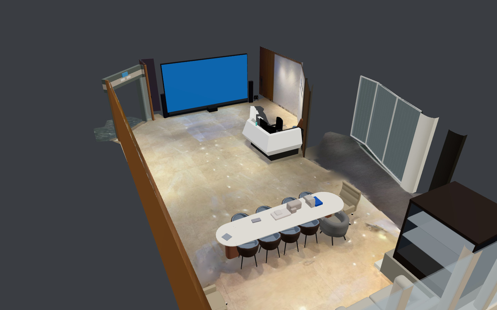
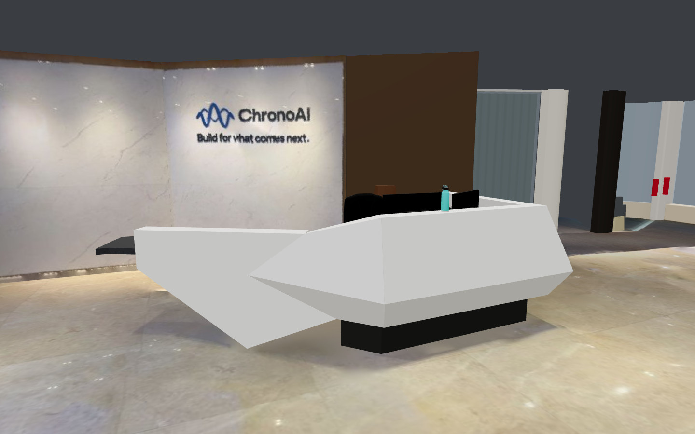
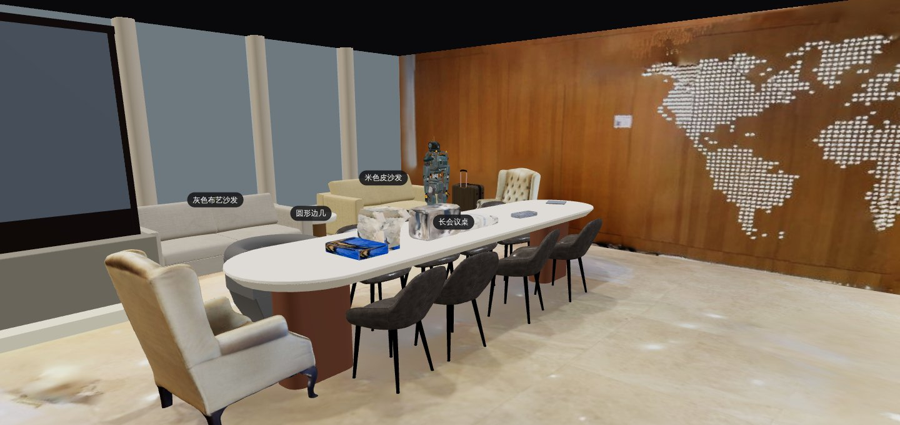
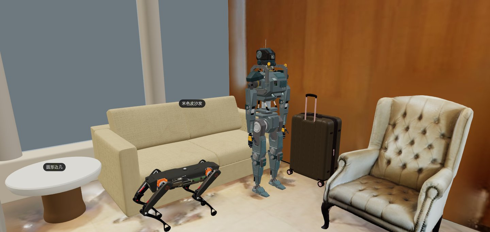

# 第一版进度报告

依据：[建设计划](BUILD_PLAN.md)。本文记录第一版的完成情况、验收结果、线上部署和还需要人工完成的事；第 7 节是服务端瘦身（整体设计第四版）的进度。

## 1. 线上地址

- 网站与接口：<https://chrono-metaverse-chronoai.apps.nyxid.ai>（chrono-cd，ChronoAI 组织，项目 `metaverse`，应用 `chrono-metaverse`）。
- 前厅演示空间：`/s/chronoai-lobby#share=<分享令牌>`。演示空间是"凭链接查看"，分享令牌只作为 chrono-cd 的密钥注入（`METAVERSE_DEMO_SHARE_TOKEN`），不在仓库里；需要链接请向部署人索取。
- 演示数据由部署配置种子自动导入（[infra/chrono-cd/demo-seed.json](../infra/chrono-cd/demo-seed.json)）。线上第 1–3 版是处理服务时期导入的（接口服务从 Scaniverse 下载前厅扫描，处理服务对齐和 AI 重建）；服务端瘦身以后，种子只导入本地产出、按哈希固定的**重建包**（第 4 版起，见第 7 节），改 `revision` 在同一空间追加一次提交，时间线上能看到前后各版。
- 健康检查：`/api/healthz`；注册给 NyxID 的接口文档：`/api/openapi.json`。

## 2. 验收结果（建设计划第 5 节）

### 2.1 单元与集成测试

| 组件 | 检查 | 结果 |
|---|---|---|
| `api`（Rust） | fmt、clippy `-D warnings`、`cargo test`（连本地 MongoDB 副本集） | 全部通过，约 224 个测试 |
| `worker`（Python，瘦身后改名 `recon/`，见第 7 节） | ruff check、ruff format、pytest（含 MongoDB 集成测试） | 全部通过，333 个测试 |
| `web`（React） | lint、typecheck、format、vitest、build、Playwright | 全部通过，265 个单元测试、14 个端到端用例 |
| `sdk/typescript` | lint、typecheck、format、vitest、build | 全部通过，186 个测试 |
| `infra` | 模拟 NyxID、部署规格检查、shellcheck、hadolint、actionlint | 全部通过 |

持续集成（`.github/workflows/ci.yml`）每次推送都跑以上检查；`images.yml` 当时构建三个镜像推到 `ghcr.io/chronoaiproject/chrono-metaverse-{api,web,worker}`（瘦身后只构建 `api`、`web`）。

### 2.2 九步端到端（本地真实 MongoDB，前厅扫描）

第一版（处理服务时期）的写法，`node infra/dev/e2e.mjs --scan <前厅扫描.zip>`，默认模式和 `--voxelize` 模式都九步全过（瘦身后的九步见第 7 节）：

1. 用测试令牌建组织空间；
2. 分片上传前厅扫描（并验证本空间可按哈希复用、别的空间不能）；
3. 处理服务完成对齐和 AI 重建，写入提交（约 1 分钟）；
4. 公开读接口按 seq 返回快照，没带或带错令牌 404；
5. 网站三种视图都能渲染（无头浏览器截图）；
6. 时间轴能回到重建前；
7. 写事件后"现在"模式能拉到；
8. 命令行 `pull → build → check → push → publish` 在地块内完成一次建造；
9. 越权操作返回 403 或 404（11 种情况）。

### 2.3 重建质量（前厅，带提示）

| 指标 | 结果 | 要求 |
|---|---|---|
| 家具区平均偏差 | 2.63 厘米（P90 6.23 厘米，3 厘米内 70%） | ≤ 3 厘米 |
| 模型大小（物体 + 结构，含贴图） | 0.37MB | ≤ 3MB |
| 物体 / 模板 | 41 个物体、2 个模板（会议椅、休闲椅） | — |

前台是折面外壳 + 台面 + 踢脚线，桌面圆角、椅子靠背弧度、沙发扶手卷边都按常见形状拟合；墙是贴图面板 + 墙体，玻璃带竖梃和窗台。对比图见 [recon/scripts/results/](../recon/scripts/results/)，做法和已知不足见 [recon/README.md](../recon/README.md) 的"前厅重建效果"。

### 2.4 部署

- chrono-cd 上应用状态就绪；公网能打开网站并看到前厅演示空间（三种视图、时间轴）。
- 公开读接口、健康检查正常；没有令牌访问 `/api/v1` 返回 401，没带分享令牌读演示空间返回 404。

## 3. 审查

- **接口约定审计**：五条组件边界（命令行↔接口、网站↔接口、处理服务↔接口存储、部署↔代码、设计↔实现）共发现约 50 处不一致，已按组件修复。
- **安全与正确性审查**：五个维度共 35 条发现，逐条由独立核实者尝试推翻，确认 31 条（高 6、中 8、低 17）。其中包括：
  - 按哈希复用上传可以接管别的主人的私有资源；
  - 删除后同名重建的空间继承旧组合成员身份；
  - 组合令牌能读到成员退出后的提交。
  确认的问题已全部修复并补了回归测试，另有 2 条留作后续（见第 5 节）。
- **资源清理栅栏**：引用已登记资源前先刷新 `touchedAt`，发布在提交事务里再确认一次，缺了返回 409 `asset_gone`。

## 4. 需要人工完成的事

1. **把服务注册成 NyxID 自定义服务**（组织管理员在自己电脑上用 `nyxid` 命令行操作，命令见 [开发教程 9.3](tutorials/cloud-claude-code-nyxid.md)）：
   - 注册时开启身份令牌（受众 `urn:chrono-metaverse:api`）和"转发调用者令牌"；
   - 注册后，把服务编号填进 chrono-cd 规格里 `metaverse-api` 的 `ALLOWED_NYX_SERVICE_IDS`。**已完成（2026-11-09）**：服务编号 `362df1f5-8135-4a05-aa85-d929a5fd9f73`，经 NyxID MCP 调 `chrono-metaverse__get_space` 返回真实数据，NyxID 读到了接口文档（47 个工具）。
   - 注册之后，AI 和命令行可以经 NyxID 读写实体区、地块和管理接口；重建层要等瘦身后的版本上线、平台管理员建好 `metaverse-rebuilder` 角色（第 7 节）。
2. **ghcr.io 镜像公开**：不需要处理，镜像已经可以匿名拉取（瘦身后只有 `api`、`web` 两个）。
3. **向平台确认可信的客户端地址请求头**：确认负载均衡只接受 Cloudflare 的流量、`cf-connecting-ip` 原样到达容器后，按 [infra/chrono-cd/README.md](../infra/chrono-cd/README.md)"公开接口限流"一节设置 `TRUSTED_CLIENT_IP_HEADER`，并调回公开接口的限流额度。在此之前，限流按连接地址计算，只能当兜底。
4. **Dependabot 告警**：GitHub 报告默认分支有 1 个中危依赖告警，合并到默认分支前看一下是否仍适用。

## 5. 已知不足与后续

- **公开事件编号**：公开编号是 `sourceEventId` 的无盐哈希，数据源用可猜的编号时，可以离线猜出非公开事件的编号（低危）。改成 HMAC 需要新增服务端密钥和轮换策略，留作设计条目；接入说明要求 `sourceEventId` 不可猜。
- **存储用量**：按哈希复用的上传和发布时合并出的操作文件还没计入空间存储用量。
- **地块合作方的 agent key**：`metaverse pull` 用的是实体区路径的只读接口，只开放地块路径的 key 需要另外开放这几个只读接口（或以后提供地块范围的读接口）。
- **重建**：
  - 入口门框还是分层挤出；
  - 镜面展示柜是纯黑圆角盒；
  - 被桌子挡住的一把会议椅分割不干净；
  - 同样输入重复导入时物体数会有小幅差异（重建不完全确定）。
- **演示令牌轮换**：改密钥不会更新已建空间的令牌哈希，要换令牌需要在 NyxID 注册后用管理接口轮换，或删空间让种子重建。

## 6. 前厅 AI 重建

演示空间的"优化模型"换成 AI 逐件做出来的前厅：[`infra/chrono-cd/demo/lobby-authored.json`](../infra/chrono-cd/demo/lobby-authored.json)（AI 物件集，设计 6.3），说明、逐件清单和完整的 CC-BY 署名见 [`infra/chrono-cd/demo/README.md`](../infra/chrono-cd/demo/README.md)。

**结果**：1 个模板、52 个物件——手写形状 36 个（13 个带烘焙指令，从扫描烘焙贴图）、Objaverse 的外部模型 10 个（8 个不同的模型，全部 CC-BY-4.0）、结构 6 个（连地面、墙、玻璃幕墙一起换，其中 3 件按扫描实测改了几何）。整房 91,110 个扫描点到模型的距离：

| | 均值（厘米） | 90% 分位 | 3 厘米以内 |
|---|---|---|---|
| 现有算法（算法物体 + 算法结构） | 7.11 | 15.13 | 51.3% |
| AI 物件集（合并稿） | 4.31 | 8.71 | 67.0% |
| AI 物件集（独立评审修正后，即线上第 3 版的 `lobby-authored.json`） | **4.19** | **8.18** | **68.2%** |

**做法**：重建工作台 `metaverse-recon`（[重建教程](tutorials/reconstruct-with-ai.md)）；从采集到上线的完整做法写成了
[方法论](methodology/README.md)（按服务端瘦身后的本地流程）。`prepare` 用线上首次导入的同一条代码路径出基线，坐标与线上一致；每件物体"先搜后写"——先去模型库（只列 CC0、CC-BY）找现成模型摆进扫描对照，偏差比现有算法差或外形对不上才手写参数形状；入口、前台、会议区、休息区、东侧隔断与柜子、杂物六组并行，最后整房评审：合并冲突、按实测改正结构、补建六组漏掉的打印桌、打印机、门、袋子和两根柱子，修掉穿插和悬空。

**本地全流程**（部署配置种子导入扫描 + 物件集，61 秒）：53 条记录、外部模型的 8 个文件下载核对后重新导出成 10 个 glb（2.44 MB）、18 处烘焙全部生成贴图（LED 大屏、EXIT 灯箱等）、52 件都有逐件偏差（中位数 2.29 厘米）、前台和桌子沙发的锚点都建了；网站优化视图的接口数据 2.85 MB、约 3 秒画出，画面底边常驻 CC-BY 署名（下面是网站优化视图的截图）。处理服务补了结构贴图的回退：物件集里本地基线算的结构贴图哈希与线上算出的不同时，按同编号、同部件路径换成线上算出的贴图，替换清单写进任务结果（`authored.textureFallback`）。

| 总览 | 前台 | 会议区 | 休息区 |
|---|---|---|---|
|  |  |  |  |

**上线**：物件集合并到默认分支后，按 [`infra/chrono-cd/demo/README.md`](../infra/chrono-cd/demo/README.md)"如何更新线上"在 `demo-seed.json` 里加 `authored`（按提交哈希固定的地址、sha256、大小）并把 `revision` 加一，同步 `app.json` 的 `METAVERSE_DEMO_SEED`。

**遗留**：镜面展示柜和玻璃没有反射材质；前台两台显示器（深色屏幕在扫描里是一团）和办公椅的偏差在 3.8–4.8 厘米；前台背后木门的烘焙贴图有几块灰斑；会议椅模板每把约 1.4 万个三角形，可以减半。

## 7. 服务端瘦身（整体设计第四版）

设计：[`docs/design/server-slim.md`](design/server-slim.md)。服务端只做鉴权、存储、时间线和通用把关，重建全部在本地：
本地工具 `metaverse-recon`（`recon/`）把扫描和 AI 物件集打成**重建包**，命令行 `metaverse bundle check / push` 检查、
上传、发布；处理服务下线，上传核对、操作文件和重建包的展开、过期清理并进接口服务的后台执行器；旧的发起接口返回 410。

**完成情况**（2026-11-10，开发分支，还没部署）：S1–S9 全部合并。部署规格（`infra/chrono-cd/app.json`）已去掉处理服务、
按新的内存预算调整接口服务、种子换成新格式（第 3 版、不带包）；要等瘦身后的镜像构建出来，在同一次 `PUT` 里一起换
（[部署说明](../infra/chrono-cd/README.md)第 3 节"换成瘦身后的版本"）。

**本地验收**（4 核机器，真实 MongoDB 副本集）：

| 项目 | 结果 |
|---|---|
| 九步验收（`infra/dev/e2e.mjs`，前厅扫描 zip） | 第一次就全过：本地工具出包 118 秒（`align` 2、`prepare` 55、`bundle --algorithm` 60）；重建身份 `bundle push --publish` 26 秒，扫描分 23 片，发布为 `rebuild` 提交；同一个包再推得到 `unchanged`；17 种越权和反例（没有重建权限、member、上传用途、`rb.` 编号、预览读原始扫描和清单、旧接口 410）都按预期返回 |
| 前厅精致模型版（本地打包 → 推送 → 网站） | 打包 40 秒、推送发布 28 秒；52 件物件、物件模型 17 个文件（8 把会议椅共用一个 glb）；网站优化视图的接口数据 18.7 MB（以前估计约 47.6 MB） |
| 种子导入重建包（本机 https，新库） | 4.8 秒导入完成，与命令行发布的结果逐项相同；重启后 `AlreadyDone` |
| 旧数据兼容（改造前的代码写出第 1–3 版，换成新代码） | 第 1–3 版的公开快照和提交列表逐字节相同；种子 `AlreadyDone`；排队中的旧种类任务被标记失败；后台迁移给 53 个旧资源补上核对结果、0 失败；按第 4 版的做法再推一个包，扫描、网页用模型和贴图都按哈希复用 |

**还要人做的**：

1. 上线顺序（设计 11.2）：NyxID 已经注册（早于瘦身版本上线），瘦身后的版本一旦写进改造前的版本读不了的数据就不能退回，
   只能前滚——这类数据不只来自重建路径，一次核对不过的上传、一次带新字段的实体区写入都算，所以实际的退回窗口是"上线以后
   第一次经接口写入之前"（`infra/chrono-cd/README.md` 第 4 节）；要不要先发只读兼容的过渡版本，需要拍板（设计 11.2 的"现状"）。
2. 请平台管理员建角色 `metaverse-rebuilder`（只含 `metaverse:rebuild:write`），分给要写重建层的人。
3. 前厅第 4 版的大文件托管方式（推荐本仓库发布页，设计 7.4、第 14 节）。
