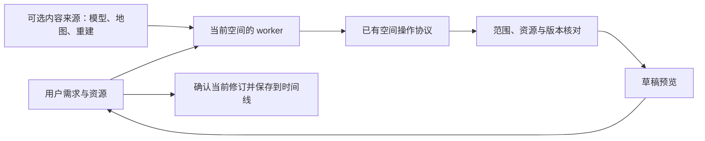

# 无需修改仓库的空间编辑

本质是在空间里放置、调整和移除内容。用户通过网页聊天提出需求、上传资源、查看预览并确认保存；worker 使用统一的编辑流程，不需要用户有代码能力、GitHub 账号、仓库写权限或部署权限。

## 核心抽象

| 概念       | 职责                                                                               |
| ---------- | ---------------------------------------------------------------------------------- |
| 资源       | 按内容哈希引用模型和贴图；也可配置公开标准数据源，由浏览器按需加载                 |
| 物件       | 一个有稳定编号、模型或参数形状、位置范围及可选属性的内容；家具、展品和建筑都是物件 |
| 操作       | 直接使用已有 `placeEntity`、`removeEntity`、锚点与方块操作；更新物件保留原编号     |
| 作用范围   | 在当前实体区或授权地块内编辑，由权限决定，和物件的业务用途无关                     |
| 草稿与修订 | 同一套检查、预览、确认和保存流程，发布绑定用户确认的修订                           |

物件是否为背景、何时显示、点击后聚焦哪里，都属于显示属性。核心不要求背景标记、编号前缀、新地块、楼层、地图来源或某种建筑形态。

## 功能划分

- 网页工作台负责聊天、向当前 worker 提供附件、显示原生预览及确认保存。
- `metaverse edit` 接收数据形式的标准操作和可选资源表，复用 SDK 的范围检查、上传和草稿能力。生成器是固定程序，用户不用写建造脚本。
- `metaverse-recon content import` 将普通 GLB 转为物件和同一编辑计划，可设置位置、朝向、缩放和可选显示属性。
- OneMap 下载、楼内配准、扫描重建和模型库是内容提供工具。它们准备资源与物件；地图旧清单在适配入口转换为标准操作，再交给通用编辑。通用层不依赖这些提供方。
- 接口服务核对权限、资源、范围、草稿修订并写入时间线。受保护重建层继续使用重建包及相应权限，这是图层边界。
- 查看器统一处理模型、形状、取景、剖切、显示条件、标记、连续地理环境和浏览器资源缓存。

放椅子、摆展品、改装饰、放建筑或整批背景，都走“读取空间 → 标准操作 → 核对 → 草稿预览 → 确认保存”。只有实际需要扩展范围时才规划新地块；已有实体区可直接编辑。

天空和地图也只是普通背景物件的 `props.environment` 配置，字段见 [形状协议](SHAPES.md#连续环境-propsenvironment)。用户可以直接提出“在这个位置使用真实海陆影像和全景天空”；worker 准备全景图、经纬度参考点和可公开访问的瓦片来源，再通过同一份编辑计划更新物件。地点、地图提供方、朝向和高度全部随物件保存，修改这些数据无需改仓库或重新部署。底图按镜头连续加载，办公室等主体保持原来的米制比例。

外部三维同样只是普通背景物件的 `props.externalContent`，通过 `format: "3d-tiles"`、来源列表和可选地理参考配置。地图与三维共用提供方署名、标志、许可链接和 HTTP 缓存规则，OneMap 只是一份场景配置。用户可以让 worker 换成其他提供方或自己的标准服务，无需修改仓库。拒绝访问的服务只尝试用户配置的备用源，不改变来源标识或转发系统登录身份。协议与限制见 [外部流式内容](SHAPES.md#外部流式内容-propsexternalcontent)。

## 防止场景依赖

生产核心不能引用 `scenes/`，也不能包含当前示例的空间编号、宿主来源编号和建筑名称。CI 检查这些依赖、通用显示层不能包含场景配置中的提供方地址，并检查通用编辑模块不能反向导入具体提供方。新增来源必须输出已有操作协议，不能向核心添加按来源或物件用途分支的处理。检查能发现已知依赖，其他形式的硬编码仍需代码审查。

工具版本随请求固定，重试保留幂等编号。资源、配置和计划写在仓库外的独立工作区；模型和物件状态发布后从空间快照恢复，换 worker 可继续调整，不依赖旧脚本。浏览器缓存按哈希复用资源；线上保存由时间线承担。

空间管理权限、地块编辑权限和重建权限保持各自的边界。公开分享快照不能编辑；用户缺少范围时由管理员提供授权地块。

## 支持范围与验证

通用编辑支持服务端已有的普通空间操作，资源支持 GLB 和 PNG/JPEG/WebP。其他来源格式由转换工具接入。网页单个附件上限 20 MiB；较大模型可由 worker 从来源下载并按平台限制拆分。地图适配器、复杂楼体配准和重建算法有各自的输入条件，均不成为普通编辑的前提。

验收覆盖普通物件新增与更新、形状和模型混合、贴图、删除、锚点及方块修改、无需背景标记或地块的导入、版本与资源错误，以及两个地图地点和不同标高/朝向的配准。接口测试使用真实 MongoDB 和模拟 NyxID/CMA，浏览器测试使用夹具；真实账号的线上 worker 全流程需部署后验收。

工具步骤见 [通用空间编辑](../sdk/typescript/skills/metaverse-builder/references/edit.md)。地图适配器另见 [背景与楼内配准](../sdk/typescript/skills/metaverse-reconstruct/references/context.md)。
