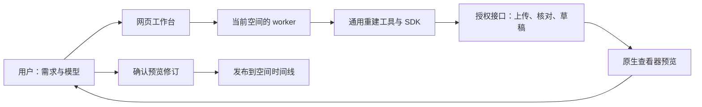

# 无需修改仓库的空间建设

空间编辑通过网页聊天完成。用户提出需求、上传模型、查看草稿、继续调整并确认保存；worker 使用通用工具，在独立工作区处理配置和模型。用户需要目标空间对应的权限，不需要 GitHub 账号、仓库写权限或部署权限。

## 功能划分

| 用户想做的事                             | 系统负责的能力                                           | 空间自己的数据                               |
| ---------------------------------------- | -------------------------------------------------------- | -------------------------------------------- |
| 从扫描建立或优化室内、修复房顶           | 重建工作台、结构与物件工具、重建包                       | 扫描、结构轮廓、重建参数                     |
| 下载周边建筑、地面影像                   | `recon/context` 的 OneMap 适配器                         | 地理范围、来源、参考点、标高、朝向、署名     |
| 使用其他地图或自带建筑                   | 网页向现有 worker 上传 GLB/ZIP，通用 GLB 导入            | 模型、米制位置与偏航                         |
| 将室内放入所在楼体                       | 通用楼面与外墙配准、近景剖面和远景外壳                   | 主体区域、楼面与外墙编号、外墙方向、切面高度 |
| 室内优先取景，拉远看整栋楼，点击标记返回 | 查看器的 `background`、`backgroundView`、`landmark` 协议 | 背景身份、距离、标记文字与返回范围           |
| 剖切房顶、重复加载更快                   | 查看器统一剖切，浏览器按资源哈希缓存                     | 当前视图设置；资源以哈希标识                 |
| 调整、预览、保存                         | SDK 范围与哈希检查、服务端权限核对、草稿修订与时间线     | 当前用户授权、草稿和提交                     |
| 换 worker 后继续编辑                     | 从空间快照恢复背景配置和清单                             | 随版本发布的 `backgroundConfig`              |

房顶几何修复使用已有重建工具；临时隐藏房顶使用查看器剖切。两者都不依赖地点或公司编号。背景导入只替换指定前缀的背景物件，保留主体、锚点和其他背景组。

## 通用性边界

生产代码不能引用 `scenes/`，也不能包含当前示例的空间编号、宿主来源编号和建筑名称。CI 自动检查这些边界；这能发现已知场景依赖，仍需代码审查识别其他形式的硬编码。地点、楼层、公司名与摆放参数属于工作区配置；调整这些数据不需要重新构建平台。

工具源码固定在每次请求记录的提交。已有请求重试沿用原版本和幂等编号；空间模型与配置写在源码仓库之外。模型上传走当前空间与地块权限，服务端核对通过后才可预览和引用。保存携带用户确认的草稿修订，草稿随后被修改时会拒绝发布，要求重新预览。

背景地块不存在时，worker 可以生成布局计划；设置布局仍要求空间管理权限。只有地块权限的用户可在管理员提供的范围内编辑。公开分享快照不能写入。

## 支持范围与验收

OneMap 适配器支持带 RTC_CENTER、_BATCHID 和建筑批次属性的 B3DM，其他来源可先转为 GLB。自动楼内配准需要 extrude 地面轮廓和带 yaw 的外墙；复杂凹楼体的截面凸包需要核对。楼层编号不能代替实测标高，估计值应在预览时交给用户确认。当前距离显示控制没有实现整座城市的流式加载。网页单个模型附件上限 20 MiB；更大模型可由 worker 从来源下载并按平台限制拆分。

验收覆盖独立工作区的两个模拟地图地点、不同标高和朝向的宿主配准、GLB 导入与配置恢复、同 worker 模型附件、地块上传权限、哈希错误、布局重叠、缓存来源切换和草稿修订保护。接口集成测试使用真实 MongoDB 和模拟 NyxID/CMA；网页端到端测试使用夹具。真实账号的线上 worker 全流程仍需部署后验收。

工具步骤见 [背景与楼内配准](../sdk/typescript/skills/metaverse-reconstruct/references/context.md)。
