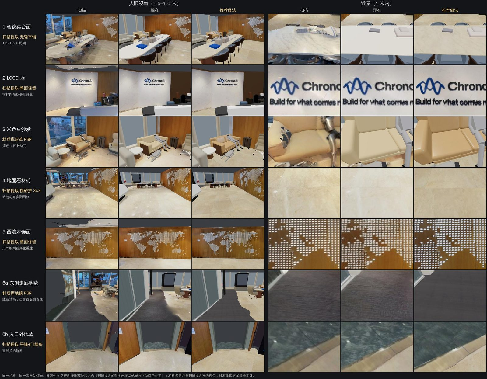

# 第 6 章 贴图手册

结构和物件做对以后，"像不像"主要看材质：石材有没有纹、木饰面有没有木纹和板缝、皮面是不是皮面、颜色和现场一不一致。
第 3 版的贴图来自扫描（烘焙或投影），近看糊、带着烤进去的高光和阴影，大面纯色的件又太平。本章按表面类型给出做法，依据是
前厅 6 类表面的贴图概念验证（6.13 节）。

外部事实（材质库和生图模型的许可、生图工具、法线工具）查证于 2026-11-10，来源列在本章末尾；查不到的没有写。

## 6.1 先分清两种贴图

| | 烘焙看法 `shading: "baked"`（默认） | 固有色 `shading: "albedo"` |
|---|---|---|
| 贴图里是什么 | 扫描拍到的颜色，**已经带着光照**（阴影、高光、明暗） | 表面本身的颜色，**不带光照** |
| 网站怎么画 | 贴图只有 0.3 倍受光照，另加 0.72 倍自发光，看起来和扫描一样 | 完整受光，法线、粗糙度、金属度起作用 |
| 用在 | 烘焙指令的结果、结构面板上投影的扫描贴图、从扫描切出来的模型 | 材质库贴图、扫描提取后**去过光照**的贴图、AI 生成的贴图、模型库的模型 |

规则见 [SHAPES](../SHAPES.md) 第 2 节"着色、法线、粗糙度"。两条推论：

- 去过光照的贴图必须写 `albedo`，然后**按网站的灯光标定颜色**（6.10 节）——同一张图在两种画法下亮度差很多；
- 网站要按 SHAPES 画着色方式、法线和粗糙度，这些字段才看得到效果（服务端瘦身设计第 12 节）。

## 6.2 怎么选做法

按顺序问四个问题：

1. **它是独一无二的内容吗**（LOGO、字样、世界地图点阵、屏幕画面、印刷的袋子、门牌）？是 → 从扫描取：大面用**正交展开、整面保留**
   （6.3 节），小件用**烘焙**（6.5 节）。不要让材质库或 AI 生图去"编"独有的内容。
2. **扫描里这块材质清楚、颜色对吗**（石材台面、地砖、地垫）？是 → **扫描正交展开 + 清理 + 无缝平铺**（6.3、6.8 节），颜色天然就对。
3. **材质库里有同类的吗**（皮革、木饰面、地毯、大理石）？有 → **材质库 PBR**（6.4 节），按扫描调色、标定，带法线和粗糙度。
   扫描里糊、褶皱和反光多的软包（皮沙发）尤其适合。
4. **都没有**（特殊面料、定制饰面）→ **AI 生图**，以照片或扫描正交图为参考（6.7 节），然后无缝、生成法线粗糙度、标定。

金属、玻璃、镜面现在只能用颜色、透明度示意（网站没有环境反射，第 8 章）。各类表面的推荐做法汇总在 6.14 节。

## 6.3 做法一：扫描正交展开 + 清理

适合扫描清楚的规律材质（取一块做成可平铺的贴图）和独一无二的大面（整面保留）。概念验证全部只用 numpy / scipy，不需要显卡。

1. **正交展开**：给表面一个坐标框（原点、向右 u、向下 v、朝外的法向 n），每个像素沿法向找离观察者最近、深度在窗口内（±3 到 ±12 厘米）、
   朝向和法向一致（夹角余弦 ≥ 0.6）的扫描三角形，插值贴图坐标后从 8192² 的原始贴图双线性取色。分辨率 3–4 毫米/像素。这比烘焙
   （随机撒点取平均）清楚，清晰度只受扫描贴图限制。
2. **掩码**：只要这块材质的像素——按颜色分（木纹饱和度高、白色大理石亮且无色、石材偏暖）；墙前的物件（比墙面凸出 3 厘米以上或
   很暗）挖掉；扫描碎片用框排除。
3. **去高光和暗斑**：比局部背景亮（或暗）很多、饱和度低的像素，再膨胀一圈，当成要补的洞。
4. **去光照**：在线性光下算亮度，按粗网格（4–6 厘米一格）取 50–60 百分位估计"背景亮度"（对字样、点阵、高光不敏感），补空、高斯
   平滑（0.25–1.2 米）后整图除以它、乘回全局中位亮度——只改亮度、不改色相。可选再做大尺度（0.4–1.5 米）的色度拉平。
   **坑**：西墙的木饰面上有白色点阵世界地图，色度拉平把点阵染黄了，最后只调亮度。
5. **补洞**：每个洞从附近干净的区域按偏移复制过来，再把边界上的差值做成平滑的"膜"加上去（近似泊松克隆：纹理来自别处，边界和
   周围接上）。竖向木纹从同一列的正上、正下方取，板缝才对得上；大洞可以用做好的平铺贴图当来源。
6. **做成可平铺的**（只对规律材质）：6.8 节。
7. **轻度锐化**（反锐化掩模）。

前厅的参数：

| 表面 | 分辨率 | 结果 | 要点 |
|---|---|---|---|
| 会议桌白色大理石台面 | 3 毫米 | 1.3 × 1.0 米的平铺块 | 去掉桌上杂物；亮度 0.35 米、色度 0.6 米去光照；拼缝合成（块 18 厘米、重叠 3.6 厘米） |
| 地面石材砖 | 4 毫米 | 3.6 × 3.6 米（3 × 3 块砖） | 先找砖缝网格（1.2 米），每块砖按"脏"的程度评分，挑最干净的 9 块拼起来；砖缝都在格子边上，回绕天然无缝 |
| LOGO 墙（大理石 + 字样） | 3 毫米 | 整面 2.6 × 2.8 米 | 背景亮度只从大理石估计；高光从附近大理石克隆；右下没扫到的大洞用本墙大理石的平铺块补；字样整面保留 |
| 西墙木饰面 + 点阵地图 | 4 毫米 | 整面 12.2 × 2.8 米 | 只调亮度；洞从同一列克隆；墙顶的扫描碎片框掉 |
| 米色皮沙发坐垫 | 3 毫米 | 0.4 × 0.4 米 | 取坐垫内部 0.7 × 0.49 米（避开缝线和斜靠的机器人）；6 厘米尺度的褶皱减弱 80% |
| 入口地垫、门槛条 | 3 毫米 | 地垫 0.75 米平铺；门槛条整条 | 地垫和门槛、门槛和石材各拟合一条直线边界，门槛条是两条线之间宽 0.29 米的带 |

扫描本身是糊的：提取出来的贴图细节比扫描少（细节比 0.2–1.0），近看仍不如材质库清楚；它的长处是颜色、纹路和现场一模一样。

## 6.4 做法二：CC0 材质库 PBR

**库**：只用 CC0 的——[Poly Haven](https://polyhaven.com/license)（贴图、HDRI、模型全部 CC0，可商用、不用署名）和
[ambientCG](https://docs.ambientcg.com/license/)（全部 CC0 1.0，可商用、可修改、可再分发，署名可选）。每个材质通常有颜色、法线
（选 OpenGL 约定的，ambientCG 的文件名带 `NormalGL`）、粗糙度三张图，2K 足够（贴图上限 4096）。

**挑**（三轮，都和扫描参考图放在一起看）：

1. 每块表面列一组候选，下载缩略图拼成带编号的色卡图，第 0 格是扫描参考；
2. 候选按**实际尺寸、同一比例**（4 毫米/像素）铺成 1.2 米见方，调色后和扫描参考并排，人眼挑；
3. 对挑中的材质比较调色参数（细节系数、色度拉平），同一比例并排再挑。

**加工**：

- **调色**：在线性光下逐通道乘系数，让平均色等于扫描参考的平均色；细节系数 k（0.3–1.0）按比例压低纹理对比（扫描是糊的，太清楚的
  大理石纹会显得假）；色度拉平（0–0.8）把纹路里的杂色（绿、橙）拉向平均色度，只留明暗。
- **按实测定平铺尺寸**：先量周期——对灰度图求方向梯度、沿一个方向投影、看自相关的峰。前厅地砖 1.2 米（贴图 2.4 米一块，2 × 2 块
  砖），砖缝在 x = 3.45 + 1.2k、z = 6.375 + 1.2k，用 `offset` 对齐；木饰面板宽 0.935 米（贴图 3.74 × 2.8 米，4 块板），横缝离地
  0.197 米和 2.62 米。
- **法线和粗糙度**用材质库自带的，强度按观感调（6.11 节）。

前厅的选择：

| 表面 | 材质（许可） | 平铺（米） |
|---|---|---|
| 会议桌台面 | ambientCG Marble005（CC0） | 2.0 |
| LOGO 墙底材 | ambientCG Marble019（CC0） | 4.0 |
| 米色皮沙发 | Poly Haven leather_white（CC0） | 0.3 |
| 地面石材砖 | ambientCG Marble014（CC0），拼成带缝的砖 | 2.4 |
| 西墙木饰面 | Poly Haven walnut_veneer（CC0），拼成带缝的板 | 3.74 × 2.8 |
| 东侧走廊地毯 | ambientCG Carpet001（CC0） | 0.6 |

CC0 不要求署名，仍在过程记录里写清用了哪个材质，方便以后换版本。

## 6.5 做法三：烘焙

手写形状的部件材质写 `{"bake": "planar", "color": [预览色]}`（也可以是 `"box"`、`"cylindrical"`），打包时由 `metaverse-recon bake`
从扫描把颜色烘焙成贴图，结果按烘焙看法画（`baked`）。

- 适合：小而独特的东西——LED 大屏的画面、EXIT 灯箱、印刷的袋子、柱子上的开关面板、门的木纹。前厅第 3 版 13 个物件、18 处烘焙。
- 烘焙在本地做，打包前就能看到结果（以前要等服务端烘焙后才看得到，本地预览只有后备纯色）。
- 坑：背面会烘到背后的东西（门的背面烘到了门后灰面的颜色）；大面平整的独有内容，用 6.3 节的正交展开更清楚。
- 屏幕、灯箱再加 `unlit: true`，不受灯光影响。

## 6.6 做法四：贴花和分区

- **贴花**（LOGO、字样、点阵地图叠在底材上）：网站现在画形状时**不用贴图的透明通道**（只有 `opacity` 小于 1 才半透明），所以独立
  贴花层还做不了。两种现在可行的写法：
  1. 整面保留扫描提取的贴图（字样和底材一起，6.3 节）——前厅的推荐做法；
  2. 把贴花合成进底材贴图：底材用材质库或扫描提取的平铺块铺满整面，再把从正交图抠出的字样合成上去，导出一张整面贴图（不平铺）。

  以后：字样换成矢量重绘、点阵地图按规则程序化生成（更清楚），等网站支持透明贴图再做成独立的贴花层。
- **分区**（同一块地面上石材、地毯、门槛条）：在地面的扫描贴图上按颜色分出各区，**边界拟合成直线**（不要沿像素锯齿），每个区建成一个
  贴地的薄物件（`extrude` 多边形），各用各的材质。前厅入口：地毯和门槛、门槛和石材各一条直线，门槛条是两线之间的带。

## 6.7 做法五：AI 生图

### 6.7.1 什么时候用、什么时候不用

- **用**：材质库里没有、扫描又糊的材质（特殊面料、定制饰面、扫描里被挡住大半的表面）。以扫描正交图或现场照片作参考，生成**干净、
  不带光照、可无缝平铺的固有色贴图**，再按 6.8–6.10 节加工。
- **不用**：独一无二的内容（LOGO、字样、地图、画面）——生图模型会把字写错、把图案改掉；也不要用它"补"扫描里不存在的东西。
- 生出来的只是一张颜色贴图：无缝（6.8）、法线和粗糙度（6.9）、颜色标定（6.10）一步都不能少。
- **还没有在前厅实测过**：前厅的 6 类表面都由扫描提取或材质库解决了，概念验证没有用 AI 生图。本节的工具、许可是查证过的，
  流程和起点参数是建议；第一次用时按 6.13 节的方法出"扫描 | 现在 | 新"对比图、算色差和细节比，再决定用不用。

### 6.7.2 模型的许可（2026-11-10 查证）

本项目是公司的产品，按**商业用途**判断。只用许可明确允许的：

| 模型 | 权重的许可 | 能不能用 | 说明 |
|---|---|---|---|
| FLUX.1 [schnell] | Apache-2.0（自编码器也是 Apache-2.0） | **可以** | 本地首选 |
| FLUX.1 [dev]，以及 Fill、Canny、Depth、Redux、Kontext、Krea 的 [dev] 版 | FLUX.1 [dev] Non-Commercial License v1.1.1 | **不用** | 许可只授权非商业用途，并写明带来收入、影响终端用户的使用都不算非商业；商用要另向 Black Forest Labs 申请许可。许可里说输出可以用于任何用途（不能用来训练竞品模型），但用它生产要上线的贴图本身就是商业使用 |
| SDXL base 1.0 / refiner 1.0 | CreativeML Open RAIL++-M | **可以** | 免费、可再分发，附带使用限制（附件 A：违法用途、伤害未成年人、虚假信息等）；许可方不主张对输出的权利 |
| SDXL 0.9 | 研究许可 | 不用 | — |
| Stable Diffusion 3.5 | Stability AI Community License | **看公司年收入** | 按 Stability 的发布说明和模型页，年收入低于 100 万美元的组织或个人可以免费商用，超过要买企业许可。许可全文这次没能直接打开核对，用之前请法务按全文确认；不确定就不用 |
| OpenAI 图像接口（GPT Image 系列） | 服务条款 | 可以（按条款） | 按 OpenAI 的条款，输出在法律允许的范围内归用户；要把参考图发给外部服务，先确认公司的数据政策（6.7.4 节） |

模型的许可经常变，仓库里的标签和模型卡、许可原文冲突时以许可原文为准（调研报告"许可要点"第 4 条）。每次换模型都在过程记录里写下模型、
版本和许可。

### 6.7.3 本地方案

**Mac（Apple 芯片）**：

| 工具 | 是什么 | 许可、价格 | 怎么用 |
|---|---|---|---|
| Draw Things | App Store 上的本地生图应用，不联网也能生成 | 免费，有应用内购买；需要 macOS 12.4 以上，为 Apple 芯片优化 | 应用里下载 SDXL、FLUX 等模型（选 6.7.2 节允许的），用图生图，参考图放扫描正交图 |
| ComfyUI | 节点式的生图工作台，原生支持 SDXL、SD3.5、Flux.1 等 | GPL-3.0，免费 | 有 macOS 桌面版；也可以手动装（README 写明支持 M1–M4 芯片：装 PyTorch 预览版后按手动安装步骤运行 `python main.py`，用 PyTorch 的 Metal 加速） |
| diffusers（Python 库） | 用脚本批量生成 | Apache-2.0 | 设备写 `mps`（官方有 Apple 芯片的使用说明），适合写成可重放的脚本 |

**NVIDIA 显卡的机器**：

| 工具 | 怎么用 |
|---|---|
| ComfyUI | 装带 CUDA 的 PyTorch（README 写明 20 系及以上显卡要用 cu130 或更新的 PyTorch），工作流可以导出成 JSON 存进过程记录，可重放 |
| diffusers | Python 脚本：图生图，批量出候选；设备写 `cuda` |

不论哪种，**固定随机种子、记下模型文件的 sha256、全部参数**，写进过程记录，结果才能重做。

### 6.7.4 接口方案（OpenAI 兼容）

OpenAI 的图像接口：

- `POST /v1/images/generations`：只有文字提示；
- `POST /v1/images/edits`：带图片（GPT Image 模型可以给一张或多张，最多 16 张）和提示，可选遮罩；还有 `size`、`quality`、`background`、
  `output_format`、`input_fidelity` 等参数。以参考图生成贴图用这个。
- 模型名以官方 SDK（`openai-python` 的 `src/openai/resources/images.py`，main 分支）的说明为准，会随时变。2026-11-10 查证时编辑
  接口列出的有：`gpt-image-1-mini`、`gpt-image-1.5`、`gpt-image-2`（及 `-2026-04-21` 快照）、`gpt-image-2.5-sunburst`、
  `gpt-image-2.5-flare`（及各自的 `-2026-09-08` 快照）、`gpt-image-2.6-sunburst`、`gpt-image-2.6-flare`、`chatgpt-image-latest`。
  `gpt-image-1` 已于 2026-10-23 停用，来源写明改用 `gpt-image-2.5-sunburst` 或 `gpt-image-2.5-flare`；`dall-e-2`、`dall-e-3` 已于
  2026-05-12 退役。用之前再查一次。

"OpenAI 兼容"的其他服务（第三方的生图服务、本地起的兼容服务器）用同样的路径和字段，换掉地址和模型名就能用；它们背后的模型许可要
单独按 6.7.2 节查。

```bash
# 密钥只放环境变量，不写进任何文件
curl -sS "$IMAGES_BASE_URL/v1/images/edits" \
  -H "Authorization: Bearer $IMAGES_API_KEY" \
  -F model="<模型名>" \
  -F image=@refshot/table-top.png \
  -F prompt="$(cat prompts/table-top.txt)" \
  -F size=1024x1024 \
  -o out.json
```

**数据**：参考图会发到外部服务。只发裁剪到材质本身的正交图或近景，画面里不能有人、屏幕内容、白板、文件；按公司的数据政策决定能不能发。

### 6.7.5 提示词模板

提示词用英文写（这些模型对英文提示的理解更好），中文是说明。尖括号里的按表面替换。

**A. 图生图（本地，参考图是扫描正交图或照片）**：

```
Seamless tileable PBR albedo texture of <material: white Carrara marble with soft grey veins>.
Orthographic, viewed straight on, uniform scale: the image spans <1.0 m x 1.0 m>, <veins 1-3 cm wide>.
Flat, even, neutral lighting. No shadows, no highlights, no reflections, no vignetting, no perspective.
Only the material surface: no objects, no text, no logos, no borders.
Match the color and pattern of the reference image.
```

反向提示（支持时填）：

```
shadow, specular highlight, reflection, glare, vignette, perspective, depth of field, objects, text, logo,
watermark, frame, border, visible seam, repeated tile grid, people
```

起点参数：重绘强度 0.35–0.55（低了带着扫描的糊和阴影，高了颜色和纹路跑掉）；1024 × 1024；出 4–8 张挑。

**B. 参考图生成（接口的 edits，或支持参考图的本地模型）**：

```
Using the attached photo only as a reference for color and pattern, create a seamless tileable albedo texture
of the same <material: beige smooth leather with fine grain>.
Remove all lighting: no shadows, highlights, reflections or vignetting.
View it straight on (orthographic), uniform scale; the image spans <0.4 m x 0.4 m>.
Only the material: no objects, seams, stitching, text or logos.
The left edge must continue seamlessly into the right edge, and the top edge into the bottom edge.
```

**C. 纯文字**（没有参考图时，例如给扫描里看不见的柜内衬）：模板 A 去掉最后一句，材质写得更具体（颜色名、颗粒大小、光泽）。

拿到图以后：先半幅错位看接缝、拼 3 × 3 看重复（6.8 节）；颜色以标定为准，不以生图的颜色为准（6.10 节）。

## 6.8 无缝平铺

**周期怎么定**：

| 材质 | 周期 | 依据 |
|---|---|---|
| 地砖 | 整数块砖（前厅 1.2 米的砖，3 × 3 块 = 3.6 米） | 实测砖缝网格；砖缝放在贴图边上，回绕天然无缝 |
| 木饰面 | 整数块板（0.935 米宽，4 块 = 3.74 米） | 实测竖缝间距 |
| 大理石、石材台面 | 1–2 米（台面 1.3 × 1.0 米） | 大的纹路不在一米内重复 |
| 皮革、布 | 0.3–0.4 米 | — |
| 地毯 | 0.6–0.75 米 | — |

**怎么做**（扫描提取和 AI 生图都适用）：

1. **对齐缝裁切**：砖、板这类有缝的，按缝裁成整数块，缝落在贴图边上；
2. **拼缝合成**（图像绗缝）：从源图取小块（10–18 厘米）重叠（2.5–3.6 厘米）拼成目标大小，重叠处走最小误差的切割线；
3. **回绕切割**：贴图左右、上下回绕相接的地方同样走最小误差的切割线；
4. **周期分解**（周期 + 平滑分解）：去掉剩下的边界色差；
5. **检查**：半幅错位看中间的十字有没有缝；拼 3 × 3 看有没有一眼就认出来的重复（某条大纹路排成网格），有就加大周期或压掉那条纹路。

**写进材质**：`tile` 是贴图在表面上每重复一次的实际尺寸（米）；`offset` 把缝对到实测位置；`rotate` 转纹理方向。顺序是先加 `offset`、再转
`rotate`、再除 `tile`（[SHAPES](../SHAPES.md) 第 2 节"贴图坐标"）。圆柱面要无缝，`tile[0]` 取周长的整数分之一。

## 6.9 从固有色生成法线和粗糙度

用材质库时直接用它自带的法线和粗糙度。扫描提取、AI 生成的贴图只有颜色，需要的话再生成：

- **法线**：亮度做高度（去掉低频，只留纹理），按梯度算法线；强度要低（`normalScale` 0.2–0.35），扫描提取的纹理本来就糊，强了像塑料浮雕。
- **粗糙度**：多数情况**不做贴图**，只写一个标量 `roughness`（≥ 0.5，6.11 节）；要做就按亮度在 0.5–1 之间小幅变化（缝、凹处更粗糙）。
- **约定**：法线贴图是 OpenGL 约定（绿色朝贴图上方，与 glTF 相同）；DirectX 约定的图要把绿色通道反过来。粗糙度贴图白 = 粗糙。

免费工具（2026-11-10 查证）：

| 工具 | 平台 | 许可 | 能做什么 |
|---|---|---|---|
| Materialize（Bounding Box Software） | Windows 64 位 | GPL-3.0，免费（下载页免费生成许可密钥） | 从固有色生成高度、金属度、光滑度，再由高度生成法线、边缘、遮蔽；光滑度要换成粗糙度：粗糙度 = 1 − 光滑度 |
| AwesomeBump | 提供 Windows、Linux 的二进制；基于 Qt，其他平台要自己编译；最新 5.1（2019） | 仓库标 GPL-3.0、说明里写 LGPL，按 GPL-3.0 对待 | 从单张图生成法线、高度、高光、遮蔽、金属度、粗糙度 |
| NormalMap-Online | 浏览器（脚本在本机运行，图不上传） | MIT | 法线贴图 |
| 自己写（numpy / scipy） | 任意 | — | 上面"法线""粗糙度"两条的做法，几十行，可重放；概念验证就是这样做的 |

这些工具只在本地处理图片；GPL 约束的是工具本身的分发，一般不约束它生成的图片，有疑问问法务。不要用不可商用的"AI 估法线"模型。

## 6.10 颜色标定

**为什么要标定**：去过光照的固有色贴图在网站上按完整受光画，和扫描（烘焙看法）的亮度、色调都不一样；材质库和 AI 生成的颜色更是只
"大致像"。标定的目标是：在网站的灯光下，新材质在人眼看来和"原始"视图里的扫描是同一种颜色。

**闭环标定**（概念验证的做法）：

1. 选机位：**人眼视角和近景都要有**，每块表面至少两个；
2. 每个机位渲染两张：扫描（"原始"视图的画法）和新材质（网站的灯光，`albedo`），外加一张只画这块表面的掩码；
3. 掩码里（腐蚀掉边缘、去掉背景）各求平均颜色（线性光），比值就是每个通道要乘的系数；系数限制在"亮度比 × [0.8, 1.25]"以内，
   防止色相被拉歪；
4. 把系数乘进贴图（或写成 `tint`），重渲染，重复 3–4 次，直到比值都在 1% 以内。

前厅的系数（线性光，红、绿、蓝）：地面 0.785 / 0.751 / 0.693，台面 0.869 / 0.820 / 0.741，LOGO 墙 0.993 / 0.954 / 0.905，西墙 0.791 /
0.947 / 1.205——提取出来的地面、台面按完整受光画，要调暗 13–31%。

**教训**：概念验证只在人眼视角一个机位上标定，换到近景时，台面的两个近景、地面的一个近景反而比不标定差 2.4–2.9 个色差单位（近景的
光照角度不同）。所以标定要用多个机位取平均，评审时另用标定没用到的机位检查（6.13 节）。

扫描本身的颜色也不是绝对准的（手机自动曝光、白平衡）；以扫描为准，是为了"原始"和"优化"两个视图切换时颜色一致。现场照片带灰卡、
色卡时可以用来核对扫描本身偏了多少。

## 6.11 着色方式、粗糙度和金属度的取值

| 字段 | 取值 | 说明 |
|---|---|---|
| `shading` | 材质库、扫描提取（去过光照）、AI 生成的贴图：`albedo`；烘焙结果、投影的扫描贴图：`baked` | 6.1 节 |
| `roughness` | **≥ 0.5** | 网站没有环境贴图，不透明面的粗糙度低于 0.5 会发暗、出亮斑（SHAPES）。概念验证的渲染里石材写过 0.3–0.35，写进记录时一律 ≥ 0.5 |
| `metalness` | 非金属 0；金属也只用颜色示意 | 网站没有环境反射，金属度高的面会发黑 |
| `normalScale` | 石材、木饰面 0.2–0.35；皮革 0.8；地毯 1.0 | 概念验证的取值，按观感调 |
| 颜色空间 | 颜色贴图 sRGB；法线、粗糙度贴图是线性数据 | 同一个哈希可能被不同用途引用，网站按（哈希，用途）分开缓存 |

## 6.12 贴回去

**材质怎么写**（会议桌台面的例子；字段规则见 [SHAPES](../SHAPES.md) 第 2 节）：

```json
{ "texture": { "file": "textures/table-top.jpg" },
  "uv": "planar", "tile": [1.3, 1.0], "offset": [0.0, 0.0],
  "shading": "albedo",
  "normalMap": { "file": "textures/table-top-normal.png" }, "normalScale": 0.3,
  "roughness": 0.6, "metalness": 0 }
```

- **AI 物件集里贴图的三种写法**：已在空间里的资源写哈希；材质库的外链写 `{url, sha256, size}`（`bundle` 下载、核对后进包）；本地生成的文件写
  `{"file": "<相对路径>"}`（工作台的约定，相对物件文件；`bundle` 读文件、算哈希、进包）。三种写法 `compare`、`assemble` 都认：`assemble`
  把 `{file}` 指的文件复制到输出目录的 `textures/`，引用改成相对 `authored.json`，外链原样保留。重建包和提交里的记录**只有哈希**，
  打包时全部换掉，物件的 `textures` 列表也由 `bundle` 写。
- **上限**：贴图 png、jpeg 或 webp，边长 ≤ 4096、像素 ≤ 4096²（`limits.json` 的 `texture`）；物件模型 glb 里内嵌的贴图边长 ≤ 2048。
- **模板实例**：实例给颜色材质时只覆盖颜色，模板部件保留自己的贴图、平铺、法线；实例给贴图材质时整个材质换掉。
- 贴好以后按第 5.5 节出人眼视角和近景的"扫描 | 现在 | 新"对比图，再打包。

**工作台的贴图命令**：四个命令已经进了本地工具（设计 13.2 S6b，参数以 `metaverse-recon <命令> --help` 为准，说明在
`recon/README.md`"贴图工作台"）。提取时的清理、去光照、无缝和生成法线、粗糙度还没有命令，按本章各节的方法自己做
（概念验证就是这样做的，只用 numpy、scipy、pillow 和工作台的渲染；那批脚本写死了本机路径，没有进仓库），做好的图交给 `texture`。

| 命令 | 做的事 | 还要自己做的 |
|---|---|---|
| `metaverse-recon refshot` | 对物件的一个面（`--object` 或 `--box`，`--face top\|bottom\|front\|back\|left\|right`，朝向 `--front`）做正交展开：面前后 `--depth`（默认 3 厘米）以内的扫描表面，每像素 `--px` 米（默认 3 毫米），`--texture` 给原始 8K 贴图更清楚；输出参考图 `refshot.png` 和 `refshot.json`（去掉高光暗斑后的中位色、覆盖率、建议的平铺尺寸） | 6.3 节第 2–5 步（清理、去光照、无缝）在参考图上自己做 |
| `metaverse-recon texsearch` | `--query` 在 Poly Haven、ambientCG（只要 CC0）检索，输出 `candidates.json` 和带编号的拼图 `sheet.jpg` | 与参考图同一比例并排比较（6.4 节"挑"的三轮） |
| `metaverse-recon texfetch` | `--from candidates.json#<编号>`（或 `--library --id`）下载颜色、法线（ambientCG 的 DirectX 约定翻成 OpenGL）、粗糙度，记下实际尺寸和许可，默认放进缓存 | — |
| `metaverse-recon texture` | 把颜色、法线、粗糙度贴图写进物件文件的一个部件（`--model`、`--part`）：贴图复制成 `{file}` 引用，材质写 `uv`、`tile`、`offset`、`rotate`、`shading`（默认 `albedo`）；`--calibrate --refshot <refshot.json>` 在网站光照下按扫描中位色标定整体增益（6.10）；`--preview` 出"扫描 \| 之前 \| 之后"对比图和色差 ΔE | 法线、粗糙度没有现成的要先生成（6.9） |

## 6.13 前厅的贴图概念验证



同一相机、同一套网站灯光。"现在"是第 3 版的做法（烘焙或投影的扫描贴图、纯色）；"推荐做法"是按表面类型组合：台面、LOGO 墙、地面、
西墙、入口地垫和门槛条用扫描提取（已按网站光照标定），沙发、东侧走廊地毯用材质库。

**口径**：6 类表面，每类人眼视角、1 米内近景各一个机位，再加提取方选的同样两个机位，共 24 个；其中材质库的 6 个人眼机位用来标定，
其余 18 个是**样本外**。每个机位在表面掩码里比两样：平均颜色与扫描的色差 ΔE（CIE76，越小越接近），细节比（第 1.4 节，越接近 1
越像扫描的纹理量；高于 1 是比扫描清楚）。

| 18 个样本外机位 | 色差 ΔE 均值 | 细节比中位数 |
|---|---|---|
| 现在（第 3 版） | 7.2 | 0.72 |
| 全部用材质库 | 4.7 | 1.32 |
| 全部用扫描提取 | 5.7 | 0.80 |
| **推荐组合** | **3.6** | **0.90** |

逐类（样本外机位的平均）：

| 表面 | 推荐做法 | ΔE 现在 → 推荐 | 细节比 现在 → 推荐 | 备注 |
|---|---|---|---|---|
| 会议桌台面 | 扫描提取，1.3 × 1.0 米无缝平铺 | 9.9 → 6.4 | 0.08 → 0.26 | 第 3 版是纯色台面；不标定的提取版 6.1 更好（6.10 节"教训"） |
| LOGO 墙 | 扫描提取，整面保留 | 2.6 → 3.0 | 0.86 → 0.96 | 第 3 版的投影贴图颜色已经很近；提取版近看更清楚。字样以后换矢量贴花 |
| 米色皮沙发 | 材质库皮革 PBR，调色 + 闭环标定 | 12.0 → 2.3 | 0.54 → 0.71 | 提取版带着褶皱和反光（11.7），不用 |
| 地面石材砖 | 扫描提取，挑砖拼 3 × 3，砖缝对齐实测网格 | 8.4 → 4.9 | 0.44 → 0.96 | — |
| 西墙木饰面 | 扫描提取，整面保留（只调亮度） | 5.9 → 3.3 | 1.26 → 1.22 | 点阵以后程序化重建 |
| 地毯和地垫 | 东侧走廊地毯：材质库地毯 PBR；入口外地垫：扫描提取平铺 + 门槛条 | 4.4 → 1.8 | 1.21 → 1.07 | 两处合在一类里算；走廊地毯绒条清楚，边界还要吸附直线；地垫和门槛条按直线拟合边界 |

结论：推荐组合在样本外机位上把色差减半，纹理量更接近扫描；收益最大的是皮沙发、台面、地面、西墙。没有一种做法对所有表面都最好，
所以按 6.2 节的四个问题逐块选。

## 6.14 各类表面推荐做法表

| 表面类型 | 例子 | 首选 | 备选 | 要点 |
|---|---|---|---|---|
| 规律的石材（台面、地砖） | 会议桌台面、地面 | 扫描正交展开 + 清理 + 无缝平铺 | 材质库大理石，调色、压细节 | 周期按天然周期或整数块砖；砖缝 `offset` 对齐实测网格；`albedo`；粗糙度 ≥ 0.5 |
| 带字样、图案的墙 | LOGO 墙 | 扫描提取，整面保留 | 底材用材质库，再合成抠出的字样 | 背景亮度只从底材估计；高光克隆补；不平铺 |
| 木饰面 | 西墙 | 扫描提取（只调亮度，整面或按板平铺） | 材质库木皮拼成带缝的板 | 板宽、横缝按实测；竖向木纹从同一列补洞 |
| 皮革、布艺软包 | 沙发 | 材质库 PBR + 闭环标定 | AI 生图（以坐垫近景为参考） | 0.3–0.4 米平铺；扫描里的褶皱和反光不要提取 |
| 地毯、地垫 | 走廊地毯、入口地垫 | 材质库地毯 PBR，或扫描提取平铺 | — | 分区按颜色、边界拟合直线；法线强度可以高 |
| 门槛条、踢脚这类窄条 | 入口门槛 | 扫描提取，整条保留 | 纯色 | 两条直线之间的带 |
| 印刷品、屏幕画面、灯箱、门牌 | LED 屏、袋子、EXIT 灯箱 | 烘焙 | 照片正交校正后贴 | `baked`；屏幕、灯箱加 `unlit` |
| 大面墙漆、白色墙垛 | — | 纯色 | 纯色 + 很淡的材质库贴图 | 颜色用 `measure --color` 的中位色 |
| 玻璃、镜面、金属 | 幕墙、隔断、展示柜 | 颜色 + 透明度；镜面用钢灰色 | — | 网站没有反射；玻璃后有窗帘就另建窗帘 |
| 库里没有、扫描又糊的特殊材质 | 定制面料、特殊饰面 | AI 生图（允许商用的模型，参考扫描或照片） | 材质库最接近的调色 | 无缝、法线粗糙度、标定都要做 |
| 外部模型自带的贴图 | 库里的椅子、沙发 | 用模型自带的 | 换候选 | 按导入后的样子看（第 4.3 节）；`albedo` |

## 查证来源（2026-11-10）

- 材质库许可：[Poly Haven 许可](https://polyhaven.com/license)、[ambientCG 许可](https://docs.ambientcg.com/license/)。
- FLUX.1：[black-forest-labs/flux 的说明](https://github.com/black-forest-labs/flux)（各模型权重的许可表）、
  [FLUX.1 [dev] 非商业许可原文](https://github.com/black-forest-labs/flux/blob/main/model_licenses/LICENSE-FLUX1-dev)。
- SDXL：[Stability-AI/generative-models 的说明](https://github.com/Stability-AI/generative-models)、
  [SDXL 1.0 许可原文](https://github.com/Stability-AI/generative-models/blob/main/model_licenses/LICENSE-SDXL1.0)。
- Stable Diffusion 3.5：[Stability 的发布说明](https://stability.ai/news/introducing-stable-diffusion-3-5)、[许可选择页](https://stability.ai/membership)
  （本次只能经搜索结果读到，没能直接打开许可全文）。
- 生图工具：[ComfyUI](https://github.com/comfyanonymous/ComfyUI)（许可、Apple 芯片和 NVIDIA 的安装、支持的模型、桌面版）、
  [diffusers](https://github.com/huggingface/diffusers)（许可、Apple 芯片说明）、
  [Draw Things 的 App Store 页面](https://apps.apple.com/us/app/draw-things-offline-ai-art/id6444050820)。
- OpenAI 图像接口：[官方 Python SDK 的图像接口](https://github.com/openai/openai-python/blob/main/src/openai/resources/images.py)（路径、参数、
  可用模型）、[使用条款](https://openai.com/policies/row-terms-of-use/)（输出的归属）。
- 法线工具：[Materialize](https://github.com/BoundingBoxSoftware/Materialize)、[CG Channel 的介绍](https://www.cgchannel.com/?p=97938)（平台、
  能生成的贴图）、[AwesomeBump](https://github.com/kmkolasinski/AwesomeBump)、[NormalMap-Online](https://github.com/cpetry/NormalMap-Online)。
