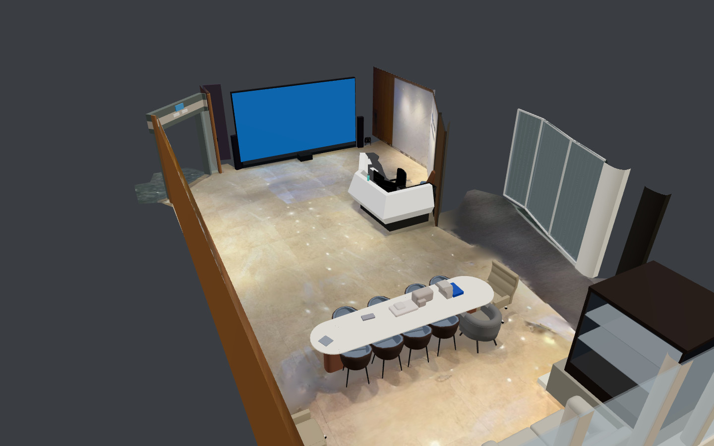
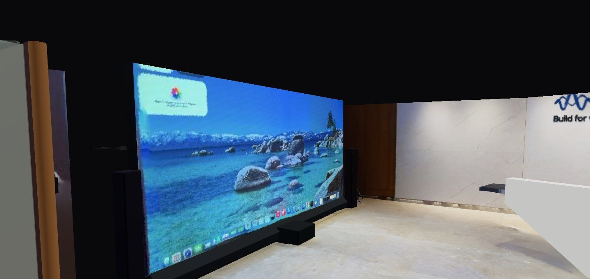
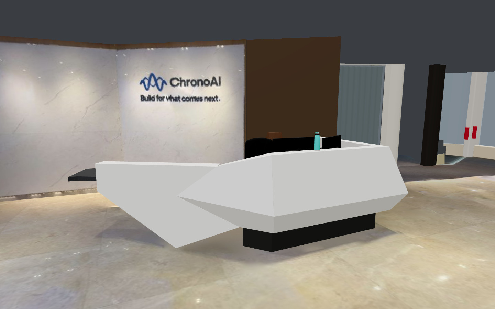
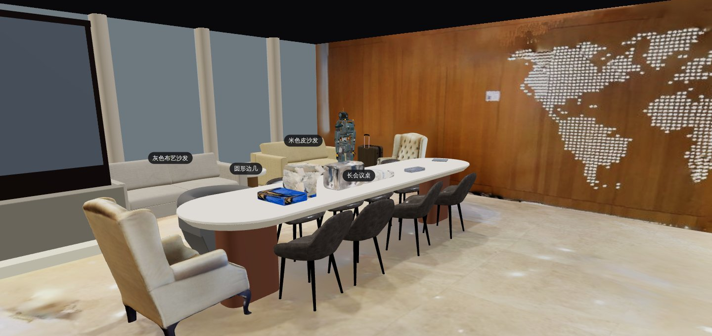
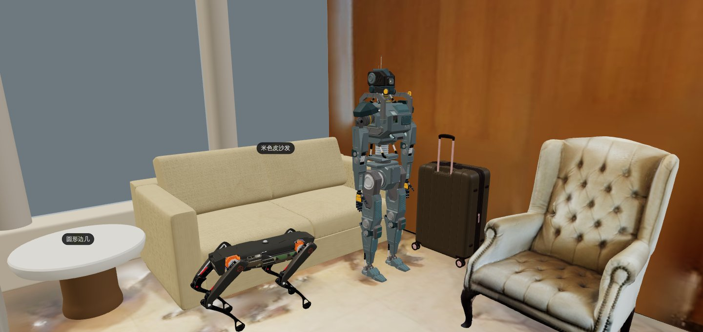

# 前厅 AI 物件集（演示空间 `chronoai-lobby`）

[`lobby-authored.json`](lobby-authored.json) 是 ChronoAI 办公室前厅的 **AI 物件集**（设计 6.3"AI 逐件建模"，格式见
[`worker/README.md`](../../../worker/README.md)"AI 物件集"）：本地的 AI 对着 Scaniverse 扫描逐件做出来的前厅，
部署配置种子导入扫描时带上它，重建层就换成这些物件（"优化模型"视图里看到的就是它们），不再用物体重建算法的结果。

| 内容 | 数量 |
|---|---|
| 模板 | 1 个（会议椅 `tpl-meeting-chair`，8 把会议椅共用） |
| 物件 | 52 个：手写形状 36 个（其中 8 个是模板实例、13 个带烘焙指令）、外部模型 10 个（Objaverse，8 个不同的模型，全部 CC-BY-4.0）、结构 6 个 |
| 结构 | `structure: "replace"`：地面、4 面墙、南面玻璃幕墙用物件集里的（算法结果按扫描实测改了 3 件的几何） |
| `notes` | 整房评审与合并报告（每件怎么来的、改了什么、偏差、遗留问题），提交时存成脚本资源，提交的 `scriptRef` 指向它 |
| 大小 | 285,415 字节（上限 4MB） |

**效果**（整房 91,110 个扫描点，剖切掉 2.2 米以上；扫描点到模型的距离，厘米）：

| | 均值 | 90% 分位 | 3 厘米以内 |
|---|---|---|---|
| 现有算法（算法物体 + 算法结构） | 7.11 | 15.13 | 51.3% |
| 六组产出直接合并、结构沿用算法（评审前） | 5.74 | 13.18 | 54.3% |
| **本物件集**（结构改正 + 补漏建 + 穿插修正） | **4.31** | **8.71** | **67.0%** |

展示图（`showcase/`）：下面"本地全流程验证"里网站"优化"视图的截图（去掉了页面的标题栏和底部控件），烘焙贴图、
灯光和网站上看到的一样：

| | |
|---|---|
|  |  |
|  |  |
|  | |

## 怎么做出来的

用的是重建工作台 `metaverse-recon`（[重建教程](../../../docs/tutorials/reconstruct-with-ai.md)），规则是技能说明
`metaverse-reconstruct`（`metaverse init` 写进工作区）：

1. **基线**：`metaverse-recon prepare` 用种子里的同一份扫描和提示，走处理服务首次导入的同一条代码路径（对齐 →
   结构 → 现有算法的物体），坐标、结构编号和线上完全一致，物件集写的坐标提交时不用换算；`base/candidates.json`
   是任务清单（41 个物体，每件建议先搜库还是直接手写）。
2. **先搜后写**：每件物体先 `views`、`measure` 看图量尺寸，再去模型库（Objaverse、Poly Haven，只列 CC0、CC-BY
   的）`search`、`place` 摆进扫描对照；偏差比现有算法差、或者外形对不上（换了 2–3 个候选都不行）才手写 SHAPES
   形状（`compare` 出"扫描 | 现有算法 | 新模型"对比图和分部件的偏差，改到不再下降）。定制件（前台、LED 大屏墙、
   入口门框、玻璃隔断、展示柜）直接手写；扫描颜色有用的部件写烘焙指令 `bake`，由处理服务从扫描烘焙贴图。
3. **六组并行**：入口、前台、会议区、休息区、东侧隔断与柜子、桌上和地上的杂物，各组按同样的规则做自己那一片，
   每件写明用了哪个库的哪个模型、试过哪些候选、为什么手写。
4. **评审**：合并六组（编号冲突、两组认领同一件时按同一范围的偏差取好的），整房出"扫描 | 现有算法 | AI 重建"
   对比图逐区看，另查部件之间的穿插：
   - **结构改正**：南面玻璃幕墙按竖梃、窗台、玻璃三类特征一起拟合（幕墙不平行于坐标轴，转 1.49°）、竖梃按实测
     位置；西侧木饰面墙按扫描平面转 −0.77°、起止点让开入口斜接板和幕墙；LOGO 墙在门边截断。墙面贴图面板保持
     原来的贴图和投影范围（截短的面板旁边放两个 2 毫米的定位小块，贴图坐标不挪位）；
   - **补漏建**：前台背后的打印桌、打印机（模型库）、棕色木门、两个袋子，玻璃隔断南端的白色墙垛和通道口的深色
     立柱（六组都没认领）；
   - **穿插和悬空**：沙发靠背伸进窗台、会议椅座面伸进桌脚、几件东西悬空 2–6 厘米等，逐一改掉。

   每件的过程、改动和偏差见 `notes`（物件集里的 `notes` 字段，也就是评审报告）。

## 逐件清单

路线："手写"是 AI 按扫描实测写的参数形状（本仓库的内容）；"+ 烘焙贴图"表示有部件写了 `bake`，提交时处理服务从扫描
烘焙贴图；"模型库"是外部模型，提交时处理服务按地址下载、核对 sha256 和大小，把旋转、缩放、调色烘进网格，重新导出
成受限的 glb。

| 区域 | 编号 | 名称 | 路线 | 来源与许可 |
|---|---|---|---|---|
| 入口 | `cabinet-01` | LED 大屏墙 | 手写 + 烘焙贴图 | 本仓库手写 |
| 入口 | `cabinet-02` | 入口玻璃门 | 手写 + 烘焙贴图 | 本仓库手写 |
| 入口 | `entrance-side-wall` | 入口内侧深色横墙 | 手写 + 烘焙贴图 | 本仓库手写 |
| 前台 | `counter-01` | 前台 | 手写 + 烘焙贴图 | 本仓库手写 |
| 前台 | `reception-bottle` | 水杯 | 模型库（Objaverse） | 《Water Bottle Simple Textures》ethan.kowalchuk，CC-BY-4.0 |
| 前台 | `reception-keyboard-1` | 键盘 | 模型库（Objaverse） | 《Keyboard》Arnau Rocher Alcayde，CC-BY-4.0 |
| 前台 | `reception-keyboard-2` | 紧凑键盘 | 模型库（Objaverse） | 《Keyboard 75%》Kenny Pang，CC-BY-4.0 |
| 前台 | `reception-monitor-1` | 显示器 | 模型库（Objaverse） | 《Computer Monitor 16:9 (Low Poly, Game Ready)》Skript47，CC-BY-4.0 |
| 前台 | `reception-monitor-2` | 显示器 | 模型库（Objaverse） | 《Computer Monitor 16:9 (Low Poly, Game Ready)》Skript47，CC-BY-4.0 |
| 前台 | `reception-office-chair` | 办公椅 | 模型库（Objaverse），调色 [141, 149, 151] | 《Office (home) black chair.》Nik Vega，CC-BY-4.0 |
| 会议区 | `tpl-meeting-chair` | 会议椅（桶形扶手椅，四条外撇细腿） | 手写（模板，8 把会议椅共用） | 本仓库手写 |
| 会议区 | `chair-02` | 会议椅 | 手写（模板 `tpl-meeting-chair` 的实例） | 本仓库手写 |
| 会议区 | `chair-03` | 会议椅 | 手写（模板 `tpl-meeting-chair` 的实例） | 本仓库手写 |
| 会议区 | `chair-04` | 会议椅 | 手写（模板 `tpl-meeting-chair` 的实例） | 本仓库手写 |
| 会议区 | `chair-05` | 会议椅 | 手写（模板 `tpl-meeting-chair` 的实例） | 本仓库手写 |
| 会议区 | `chair-07` | 会议椅 | 手写（模板 `tpl-meeting-chair` 的实例） | 本仓库手写 |
| 会议区 | `chair-08` | 会议椅 | 手写（模板 `tpl-meeting-chair` 的实例） | 本仓库手写 |
| 会议区 | `chair-09` | 会议椅 | 手写（模板 `tpl-meeting-chair` 的实例） | 本仓库手写 |
| 会议区 | `chair-10` | 会议椅 | 手写（模板 `tpl-meeting-chair` 的实例） | 本仓库手写 |
| 会议区 | `chair-11` | 灰色桶形会议椅 | 手写 | 本仓库手写 |
| 会议区 | `meeting-notebook` | 桌上的灰色笔记本 | 手写 | 本仓库手写 |
| 会议区 | `table-01` | 长会议桌 | 手写 | 本仓库手写 |
| 休息区 | `chair-06` | 休闲椅（高背行政椅） | 模型库（Objaverse），调色 [232, 220, 204] | 《Low Poly Executive Conference Room Chair》Jeremy E. Grayson，CC-BY-4.0 |
| 休息区 | `chair-12` | 休闲椅（高背行政椅） | 模型库（Objaverse），调色 [232, 220, 204] | 《Low Poly Executive Conference Room Chair》Jeremy E. Grayson，CC-BY-4.0 |
| 休息区 | `clutter-08` | 行李箱 | 手写 | 本仓库手写 |
| 休息区 | `clutter-09` | 机器狗 | 手写 | 本仓库手写 |
| 休息区 | `lounge-robot` | 人形机器人（斜靠在米色沙发上） | 手写 | 本仓库手写 |
| 休息区 | `sofa-01` | 米色皮沙发 | 手写 | 本仓库手写 |
| 休息区 | `sofa-02` | 灰色布艺沙发 | 手写 | 本仓库手写 |
| 休息区 | `table-02` | 圆形边几 | 手写 | 本仓库手写 |
| 东侧隔断与柜子 | `cabinet-03` | 东侧玻璃隔断 | 手写 | 本仓库手写 |
| 东侧隔断与柜子 | `cabinet-04` | 杂物（布袋） | 手写 | 本仓库手写 |
| 东侧隔断与柜子 | `cabinet-05` | 镜面玻璃展示柜 | 手写 | 本仓库手写 |
| 东侧隔断与柜子 | `cabinet-06` | 东南角白色墙垛（挂灭火器） | 手写 | 本仓库手写 |
| 东侧隔断与柜子 | `cabinets-se-curved-window` | 东南角弧形窗（窗台 + 玻璃） | 手写 | 本仓库手写 |
| 杂物 | `clutter-01` | 黑色背包 | 模型库（Objaverse），调色 [227, 227, 255] | 《Plain Backpack》eeelabvisual，CC-BY-4.0 |
| 杂物 | `clutter-02` | 蓝色购物袋 | 手写 + 烘焙贴图 | 本仓库手写 |
| 杂物 | `clutter-04` | 桌上的白色袋子和包装盒 | 手写 + 烘焙贴图 | 本仓库手写 |
| 杂物 | `clutter-05` | 桌上的白色纸袋和蓝色文件夹 | 手写 + 烘焙贴图 | 本仓库手写 |
| 杂物 | `clutter-table-pouch` | 桌上的格纹手拿包 | 手写 + 烘焙贴图 | 本仓库手写 |
| 评审补建 | `pillar-01` | 白色墙垛（玻璃隔断南端） | 手写 + 烘焙贴图 | 本仓库手写 |
| 评审补建 | `pillar-02` | 深色立柱（通道口南侧） | 手写 + 烘焙贴图 | 本仓库手写 |
| 评审补建 | `reception-black-bag` | 黑色袋子（打印桌角、靠门） | 手写 + 烘焙贴图 | 本仓库手写 |
| 评审补建 | `reception-door` | 前台后的棕色木门 | 手写 + 烘焙贴图 | 本仓库手写 |
| 评审补建 | `reception-print-desk` | 打印桌（深色矮桌） | 手写 | 本仓库手写 |
| 评审补建 | `reception-printer` | 打印机 | 模型库（Objaverse），调色 [50, 50, 52] | 《Printer- Low Poly》CG Buzz，CC-BY-4.0 |
| 评审补建 | `reception-red-bag` | 红白花纹袋子（靠门立在打印桌上） | 手写 + 烘焙贴图 | 本仓库手写 |
| 结构 | `floor` | 地面 | 结构，算法原样，扫描贴图 | 处理服务算法 |
| 结构 | `glazing-z15.38-1` | 玻璃（南面幕墙：窗台、玻璃、5 根竖梃） | 结构，算法结果按实测改几何 | 处理服务算法 + 本仓库手改 |
| 结构 | `wall-a211-1` | 墙面（前台后的 LOGO 墙） | 结构，算法结果按实测改几何，扫描贴图 | 处理服务算法 + 本仓库手改 |
| 结构 | `wall-x1.14-1` | 墙面（西侧木饰面墙） | 结构，算法结果按实测改几何，扫描贴图 | 处理服务算法 + 本仓库手改 |
| 结构 | `wall-x3.03-1` | 墙面（入口右侧木墙） | 结构，算法原样，扫描贴图 | 处理服务算法 |
| 结构 | `wall-x9.55-1` | 墙面（东墙北段，大屏和 LOGO 墙之间） | 结构，算法原样，扫描贴图 | 处理服务算法 |

锚点：处理服务按类别建（`props.category`）——长会议桌 `table-01`、圆形边几 `table-02`（桌子）、前台 `counter-01`、
两张沙发 `sofa-01`、`sofa-02`（区域）；椅子没有在提示里要求座位锚点，不建。

## 模型来源与署名

10 个外部模型物件用了 Objaverse 里的 8 个模型，都是 [CC BY 4.0](https://creativecommons.org/licenses/by/4.0/)
（署名即可商用，不传染）。文件经 Objaverse 在 Hugging Face 上的数据集（`allenai/objaverse`）下载，来源页是作者在
Sketchfab 上发布的原页面。**改动**：处理服务把物件集里的旋转、缩放和调色（`tint`）烘进网格，按物件模型的限制减面、
缩小贴图后重新导出 glb；没有改动模型的外形设计。署名随每个物件记录的 `props.source` 保存，网站在场景里有 CC-BY
模型时画面底边常驻一行简短署名，"全部来源"列出完整的标题、作者、许可和来源页，并注明模型经处理后重新导出（与原文件
不同），点选物件时信息面板里也有。

| 标题 | 作者 | 来源页 | 许可 | 用在 | 原文件字节数 |
|---|---|---|---|---|---|
| Low Poly Executive Conference Room Chair | Jeremy E. Grayson | <https://sketchfab.com/3d-models/2d5349cf3aec4578ad94568aedc56eab> | CC-BY-4.0 | `chair-06`、`chair-12` | 55,452 |
| Plain Backpack | eeelabvisual | <https://sketchfab.com/3d-models/e67e1b3c67804122b70eef386ebdc0be> | CC-BY-4.0 | `clutter-01` | 852,064 |
| Water Bottle Simple Textures | ethan.kowalchuk | <https://sketchfab.com/3d-models/910cf7e424e6433abc8a7763bcf9f323> | CC-BY-4.0 | `reception-bottle` | 405,020 |
| Keyboard | Arnau Rocher Alcayde | <https://sketchfab.com/3d-models/e0d3de544b824070925f28a191c789a9> | CC-BY-4.0 | `reception-keyboard-1` | 696,192 |
| Keyboard 75% | Kenny Pang | <https://sketchfab.com/3d-models/d859eb1b182d46dbad4e1cdefd8255b4> | CC-BY-4.0 | `reception-keyboard-2` | 679,588 |
| Computer Monitor 16:9 (Low Poly, Game Ready) | Skript47 | <https://sketchfab.com/3d-models/336de680dd9a4d84943d05d9c7dde1b0> | CC-BY-4.0 | `reception-monitor-1`、`reception-monitor-2` | 310,624 |
| Office (home) black chair. | Nik Vega | <https://sketchfab.com/3d-models/fa8b3412aa10480f9a38aedadd0fbac8> | CC-BY-4.0 | `reception-office-chair` | 2,576,732 |
| Printer- Low Poly | CG Buzz | <https://sketchfab.com/3d-models/8a3a68f84f4d4a34973b527875a7314b> | CC-BY-4.0 | `reception-printer` | 915,264 |

下载地址（`model.url`）都在 `huggingface.co`，会重定向到 `hf.co` 的 CDN 子域名（实测 `us.aws.cdn.hf.co`），处理服务
的 `WORKER_MODEL_HOSTS`（`huggingface.co`、后缀 `.hf.co`）覆盖了这两跳。

## 结构贴图

结构物件里的地面和墙面贴图面板引用的是本地基线（`prepare`）算出的贴图哈希。线上处理服务在提交这份物件集的任务里
会再跑一次结构算法：算出的贴图与基线相同就直接用；依赖版本稍有不同、哈希对不上时，处理服务按**同编号、同部件
路径**换成本次算出的贴图（`uv` 保持物件集里写的），替换清单写在任务结果的 `authored.textureFallback` 里
（[`worker/README.md`](../../../worker/README.md)"AI 物件集"的"已有贴图"）。5 处贴图（`floor` 的 `$`，4 面墙的
`$.children[0]`）的编号和部件路径与基线结构一一对应；`wall-x1.14-1`、`wall-a211-1` 截短后保留了原投影范围的定位块，
回退后贴图坐标不变。

回退只认编号和部件路径：线上算出的墙编号变了（例如成了 `wall-x1.13-1`）时任务失败、不重试，`lastError` 写着是哪件
物件的哪个路径。这时把那几处材质 `{"texture": …, "uv": "planar"}` 换成烘焙指令 `{"bake": "planar"}`（处理服务从扫描
烘焙贴图，不依赖结构算法的编号），重新合并、按下面"如何更新线上"改种子并把 `revision` 再加一。

## 如何复现

需要处理服务的虚拟环境（`cd worker && uv venv .venv && uv pip install --python .venv/bin/python -e '.[dev]'`，带
`metaverse-recon`）和渲染工具（`metaverse-recon doctor` 查看；`web/` 下 `npm ci` 后就有 three）。扫描用种子里的
两个文件（[`../demo-seed.json`](../demo-seed.json) 的 `files`，下载后核对 sha256），提示就是种子里的 `hints`：

```bash
mkdir -p lobby && cd lobby
curl -LO https://scaniverse.com/api/media/p7tckeaqoqjhr6z7/mesh.drc
curl -LO https://scaniverse.com/api/media/p7tckeaqoqjhr6z7/tex.jpg
jq '.hints' <仓库>/infra/chrono-cd/demo-seed.json > hints.json

# 1. 基线（处理服务首次导入的同一条代码路径）
metaverse-recon prepare --scan mesh.drc --texture tex.jpg --hints hints.json --out base
export METAVERSE_RECON_BASE=$PWD/base

# 2. 逐件：看、量 → 搜、摆 → 搜不到就手写、对比（每件一个目录）
metaverse-recon views   --object sofa-01 --out work/sofa-01/views
metaverse-recon measure --object sofa-01 --heightmap 0.05:1.0 --hm-cell 0.1 --out work/sofa-01/m.json
metaverse-recon search  --query "<英文描述>" --category chair --library objaverse --limit 20 --out work/<编号>/search
metaverse-recon place   --object <编号> --candidate work/<编号>/search/candidates.json#<候选号> \
    --scale axis --tint --out work/<编号>/place      # 外部模型：entity.json 带地址、哈希、署名
metaverse-recon compare --object counter-01 --model work/counter-01/entity.json --color-parts \
    --out work/counter-01/cmp                     # 手写：扫描 | 现有算法 | 新模型

# 3. 合并、整房检查（连结构一起换）
metaverse-recon assemble --entities work/set/*.json --structure replace --notes report.md --out out
```

`assemble` 最后跑一遍处理服务收到物件集时的校验（`parse_authored`），通过了就是 `out/authored.json`，`room.jpg` 是
整房三列对比、`report.json` 是逐件偏差和漏建的扫描团块。要直接核对本目录的定稿：

```bash
cd worker && .venv/bin/python -c "import json; from metaverse_worker.authored import parse_authored; \
p = parse_authored(json.load(open('../infra/chrono-cd/demo/lobby-authored.json'))); \
print(len(p['templates']), len(p['entities']), len(p['models']))"      # 1 52 10
```

本地全流程（种子导入扫描 + 物件集，网站打开看效果）：把 `demo-seed.json` 复制一份，`authored.url` 改成本机 http 服务
（例如 `python3 -m http.server --directory infra/chrono-cd/demo 18199` 后写 `http://127.0.0.1:18199/lobby-authored.json`，
种子只对 `127.0.0.1` 放行 http），再 `infra/dev/up.sh --demo-seed=<这份种子>`（[`infra/dev/README.md`](../../dev/README.md)）。

## 如何更新线上

线上演示空间由部署配置种子导入（[`../README.md`](../README.md) 第 8 步"演示数据"）。物件集改了以后：

1. 改好的物件集合并到默认分支，记下这次提交的 **40 位提交哈希**；
2. 改 [`../demo-seed.json`](../demo-seed.json) 的 `authored`（地址必须按提交哈希固定，不能写分支名）：

   ```json
   "authored": {"url": "https://raw.githubusercontent.com/<组织>/<仓库>/<40 位提交哈希>/infra/chrono-cd/demo/lobby-authored.json",
                "sha256": "<sha256sum infra/chrono-cd/demo/lobby-authored.json 的结果>",
                "size": <wc -c 的字节数>}
   ```

   并把 `revision` 加一；
3. 同步 `app.json`：`node infra/dev/demo-seed.mjs compact infra/chrono-cd/demo-seed.json` 的输出就是
   `METAVERSE_DEMO_SEED` 的值，跑 `node infra/chrono-cd/check-app.mjs`，再按 [`../README.md`](../README.md) 第 8 步
   "重新导入"只改这一项。

接口服务重启后在同一个空间里建一个新的 `scan_import` 任务（带 `authoredAsset`，沿用这份扫描以前的变换），一次提交
把重建层换成物件集；空间和演示链接不变。任务结果的 `authored.fit` 是逐件偏差，`authored.textureFallback` 是结构
贴图的替换清单，`authored.downloads` 是外部模型的下载统计。

## 本地全流程验证

2026-11-09 在本机（4 核）用 `infra/dev/up.sh --demo-seed=<种子>` 起全套：种子照抄 `demo-seed.json`，`authored` 指向
本机 http 服务提供的本文件，扫描照常从 scaniverse.com 下载。一个全新的空间里，种子建的 `scan_import` 任务一次完成
导入扫描和写入物件集（提交 #2"导入扫描 bfda42ee4c47（首次自动对齐，AI 物件集）"），用时 61 秒（读取 1 秒、网页用
模型 9 秒、物件集 44 秒）：

| 项目 | 结果 |
|---|---|
| 物件 | 53 条重建层记录（结构 6、物体 46、模板 1），与物件集一致 |
| 外部模型 | 8 个文件全部下载并核对（6,490,936 字节，每个都从 `huggingface.co` 重定向一跳到 `us.aws.cdn.hf.co`，`WORKER_MODEL_HOSTS` 覆盖）；重新导出成 10 个 glb、合计 2,444,636 字节、66,396 个三角形，都登记成资源 |
| 烘焙贴图 | 13 个物件的 18 处烘焙全部生成贴图、没有退回后备纯色：LED 大屏（27.9 KB，桌面画面清楚）、入口门头的 EXIT 灯箱、前台、门、袋子、柱子等 |
| 结构贴图 | 物件集引用的 5 张结构贴图本空间原来没有，本次任务的结构算法算出了完全相同的哈希，直接登记（`textureFallback` 为空）；另把这 5 个哈希改成别的再提交一次重建，处理服务按编号和部件路径换成本次算出的贴图，替换清单列出 5 处 |
| 逐件偏差 | 52 件都有 `fit`：均值 1.11–4.78 厘米（中位数 2.29），46 件 ≤ 3 厘米，3 厘米内比例的中位数 71.5%；最大的是前台两台显示器（3.83、4.78，深色屏幕扫成一团）和办公椅（3.78） |
| 锚点 | 前台 `counter-01`、长会议桌 `table-01`、圆形边几 `table-02`（桌子），两张沙发 `sofa-01`、`sofa-02`（区域） |

网站（无头浏览器打开 `/s/chronoai-lobby#share=<令牌>`）：优化视图 52 个物件（8 个模板实例、23 处贴图）、13.7 万个
三角形，约 3 秒画出；接口数据合计 2.85 MB（外部模型 glb 2.44 MB，最大的是键盘 0.51 MB、背包 0.45 MB、紧凑键盘
0.44 MB；贴图 0.29 MB；快照等 JSON 0.11 MB），远低于 40 MB，不用换更小的模型。画面底边常驻"模型来源：…，共 8 项"，
"全部来源"列出 8 个模型的标题、作者、CC BY 4.0 和来源页。原始视图加载的是扫描的网页用模型（13.4 MB）。
