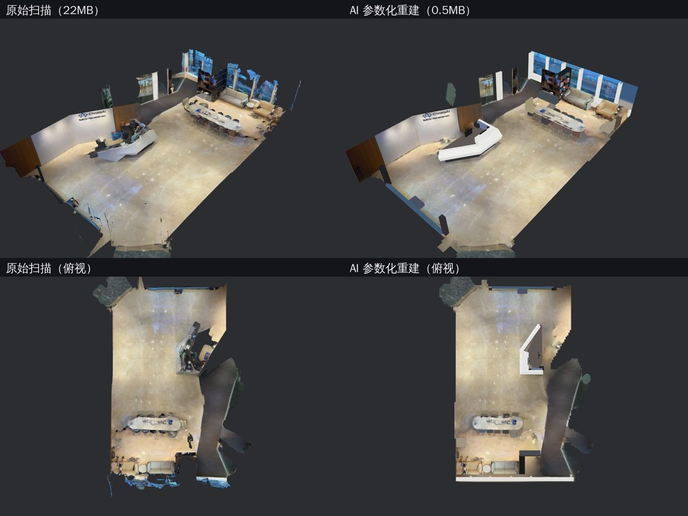
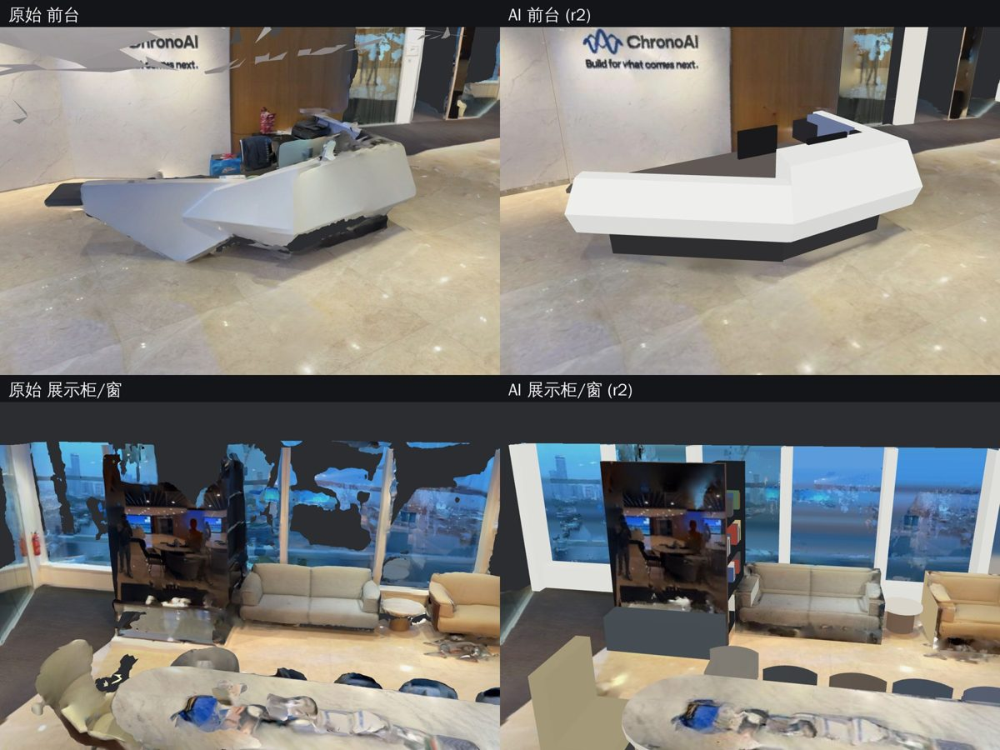

# 第 0 阶段验证：网格只定位，AI 参数化重建

验证"网格只用于标记位置，形状由 AI 用参数化几何完整还原"是否可行。输入和方块验证（`../voxelize/`）相同，都是公司前厅的 Scaniverse 扫描（[在线版本](https://scaniverse.com/scan/p7tckeaqoqjhr6z7)）。这是一次性的验证代码，不是正式实现。





## 结果

| | 原始扫描 | 方块 5 厘米 | AI 参数化重建 |
|---|---|---|---|
| 数据量 | 22MB（网页用 glb） | 32MB | **0.5MB，4,468 个三角面** |
| 外观 | 有破洞、噪点、斜面 | 能认出布局，边缘是锯齿 | 墙直地平，物体比例真实 |
| 与扫描的距离 | — | — | 平均 5.2 厘米，89.7% 的扫描表面在 10 厘米以内；地面范围内平均 3.4 厘米 |

重建内容：
- **结构**：1 块地面、5 段实墙、2 段玻璃（含斜放的 Logo 墙和斜向玻璃隔断）。贴图从扫描正交投影烘焙，Logo、世界地图墙、大屏画面都清楚。
- **物体**：23 个，180 个基本形体，包括：
  - 折面造型的前台（含显示器和杂物）；
  - 长会议桌和 10 把椅子；
  - 两张沙发、边几、单人休闲椅；
  - 镜面展示柜加开放书架；
  - 6 根窗框竖梃、窗台、立柱。

每个物体都有建议的锚点编号（例如 `counter-01`、`table-01`），可以直接作为孪生里的锚点。

场景描述就是 `scene/structure.json` 和 `scene/objects.json`：每个物体由基本形体（盒子、圆柱、挤出、剖面挤出、圆锥等）加尺寸、位置、颜色或贴图组成，也就是"程序写出来的模型"。

## 做法

两轮，由 AI 代理完成：
1. **结构**（`structure.py`）：
   - 用法线和坐标直方图找地面、墙面（包括非轴向的墙）；
   - 按 0.5 米分段处理扫描漂移；
   - 墙角吸附；
   - 按 1 厘米/像素把扫描贴图投影到每个平面，补洞后得到贴图。
2. **物体**（`prep.py`、`fit_objects.py`）：
   - 去掉地面和墙的点，在水平面上聚类；
   - AI 看渲染图和点云切片，判断每簇是什么、该怎么拆；
   - 尺寸、高度、颜色都从点云统计拟合（台面高度取朝上点的中位数，椅子位置取靠背点的直方图峰值，等等）。
3. **合成与评估**（`build.py`、`prims.py`、`bake_util.py`、`eval_fit.py`）：生成 glb，用和网站同一套 three.js 渲染对比，计算扫描表面到模型的距离。
4. **第二轮**（`refine_r2.py`）：评审代理找出最影响辨认的 5 处差异，AI 据此修正：
   - 前台改成实测剖面的折面造型；
   - 加窗框竖梃；
   - 展示柜贴上镜面并改成开放书架；
   - 补上东侧玻璃隔断；
   - 颜色改用受光面取色。

   修正后平均误差从 7.4 厘米降到 5.2 厘米。

## 局限

- **识别靠人工判断**："这一簇是什么、拆成哪几块"是 AI 看图后逐个判断的；数值参数才是自动拟合的。换一个场景要重新做识别，或者接入物体识别。
- **斜面靠近似**：基本形体只支持绕竖直轴旋转，后仰的椅背、斜切的台面只能近似。
- **难建模的东西**：玻璃（扫描本身很散）、镜面反射、桌面杂物、人形机器人等没有建模或只是近似；复杂物体可以改为从模型库选相似模型，或保留扫描碎片。
- **颜色偏差**：颜色来自带烘焙光照的扫描贴图，背光面偏暗。

## 运行

脚本按原始验证时的目录布局编写：扫描文件放在上一级目录的 `scan-assets/`（`mesh.drc`、`tex.jpg`，从 Scaniverse 下载），中间结果写到 `out/`。依赖与 `../voxelize/requirements.txt` 相同。

```bash
python structure.py      # 结构与贴图 -> out/structure.json, out/tex/
python fit_objects.py    # 物体拟合 -> out/objects.json
python refine_r2.py      # 第二轮修正
python build.py          # 合成 glb 并计算误差
```
