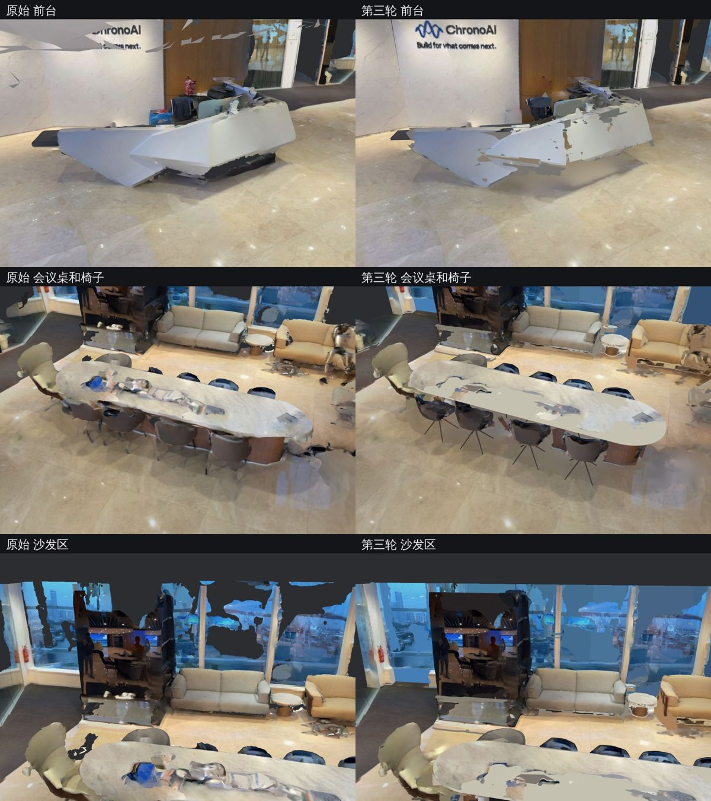

# 第 3 轮：按扫描轮廓重建

在第 2 轮（基本形体）的基础上，第 3 轮直接从扫描网格取形状。

## 做法

- **截面轮廓放样**（`contour.py`）：按物体自身尺寸决定切片间距和简化容差，坐标连续，最后做贴图转移。
- **墙面**（`wallfit.py`、`structure_r3.py`）：按顺序做 RANSAC 平面拟合，保留墙面倾斜，并按偏差分段。
- **地面**（`floor_r3.py`）：用 B 样条拟合地面高度曲面，地面轮廓用连续多边形。
- **前台、桌子**（`planar.py`）：拟合平面片，并在交线处裁剪。
- **会议椅**（`chairs_*.py`）：8 把同款椅子对齐、合并点云、按对称补齐，再做成模板，各处按实例摆放；另外 2 把椅子单独建模。
- **合成与评估**：`build_r3.py`。

## 结果（与第 2 轮对比，指标方法相同）

| | 第 2 轮 | 第 3 轮 |
|---|---|---|
| 平均偏差 | 5.15 厘米 | 2.61 厘米 |
| 2 厘米以内 | 42.7% | 81.9% |
| 家具区平均 | 3.86 厘米 | 1.48 厘米 |
| 模型大小 | 0.5MB | 5.5MB |

## 结论

- **误差大幅下降**：数字上比第 2 轮好很多。
- **视觉上被扫描噪声带偏**：前台碎成很多平面片，部分表面因为没有扫描来源，退回成纯色。
- **定下产品方向**：用户确认形状要"按常见形状拟合，保留大棱角和弧度"，干净规整优先，不要逐点贴合扫描。正式版的重建模块会这样做：
  - 先用本轮的轮廓工具测量尺寸和特征；
  - 再拟合成 [SHAPES.md](../../../docs/SHAPES.md) 里的常见形状，包括圆角盒、倒角、带圆弧的挤出、旋转体、扫掠管和少量截面放样；
  - 贴图沿用本轮的转移方法。

脚本按原始验证时的目录布局编写，用来记录做法，不是正式实现。
