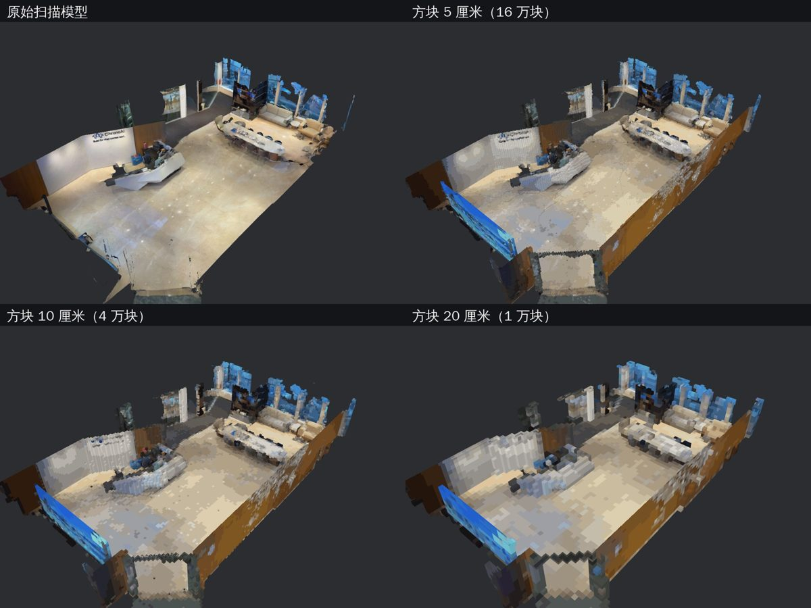
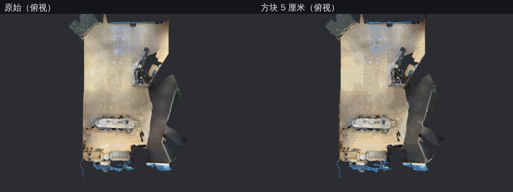

# 第 0 阶段验证：扫描模型 → 方块模型

用公司前厅的 Scaniverse 扫描（[在线版本](https://scaniverse.com/scan/p7tckeaqoqjhr6z7)）验证"扫描 → 对齐 → 体素化 → 取色 → 截图"这条流程是否可行。这是一次性验证代码，不是正式实现。





## 结果

输入：Scaniverse 网格模型（Draco 压缩，约 25 万顶点、34 万三角面）+ 8192×8192 贴图。对齐后范围约 11.7 × 3.3 × 17.4 米，表面积约 379 平方米。

| 格子尺寸 | 方块数 | 32³ 区块数 | 处理耗时 |
|---|---|---|---|
| 5 厘米 | 163,372 | 155 | 3.5 秒 |
| 10 厘米 | 40,335 | 28 | 0.7 秒 |
| 20 厘米 | 10,031 | 6 | 0.2 秒 |

（不含解码和贴图加载，整次运行约 11 秒；颜色聚成 64 种方块。）

结论：

- 5 厘米时 Logo 墙、前台、长桌、沙发都能认出来，适合做"实体区"的数字孪生；10 厘米能看出布局；20 厘米接近 Minecraft 的方块感。
- 数据量很小：5 厘米也只有 155 个区块，存储和网页加载都不是问题。
- 自动对齐有效：按墙面法线方向旋转约 −61°，墙和网格对齐，没有锯齿。

## 踩到的坑

- **贴图坐标原点在左上角**（图片坐标习惯）。按 OpenGL 习惯从左下角读，贴图会完全错乱。`uvtest.py` 的做法是比较两种读法下三角形内部颜色的一致性，一致性高的就是对的。导出 glTF 时 trimesh 会再翻转一次 v，所以导出前要先翻转。
- **顶点颜色要转线性空间**：glTF 规定顶点颜色是线性值，直接写 sRGB 字节会显得发白。
- **扫描有天花板**：俯视时需要剖切（`cut` 参数）或背面剔除，才能看到室内。

## 运行

```bash
python3 -m venv .venv && .venv/bin/pip install -r requirements.txt
# 从 Scaniverse 下载 mesh.drc 和 tex.jpg（需要能访问 scaniverse.com）
.venv/bin/python voxelize.py mesh.drc tex.jpg out 0.05 0.1 0.2

cd viewer && npm install && ln -s ../out models
node render.js "$PWD" ../shots '[["orig","m=original.glb&cut=2.3"],["v5","m=voxel_5cm_pal64.glb&cut=2.3"]]'
cd .. && .venv/bin/python grid.py shots compare.jpg "orig=原始" "v5=5 厘米"
```

截图用无头 Chromium 的软件渲染（不需要显卡），和以后网站用的是同一套 three.js 渲染代码。
